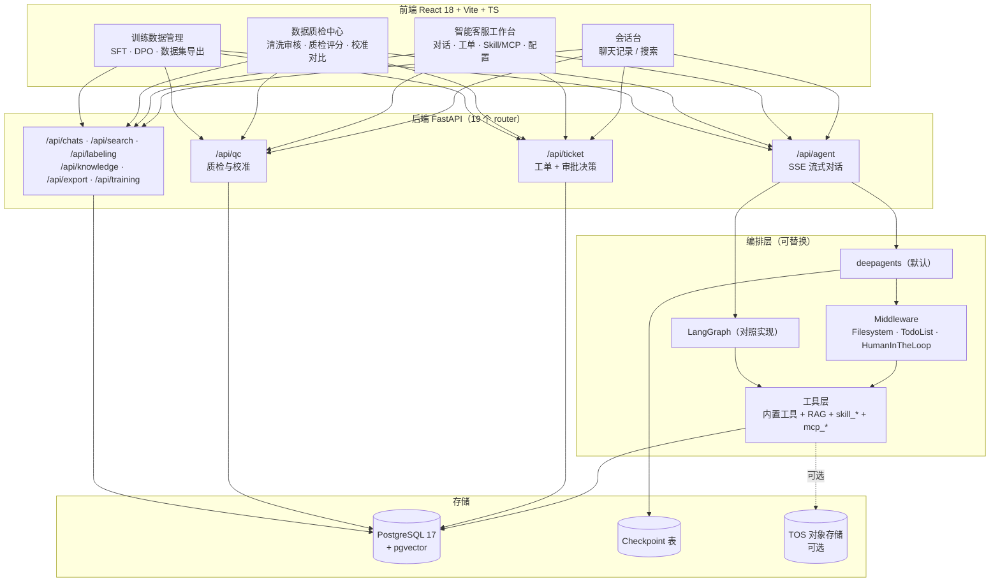

# Agent CS

**面向客服场景的 Agent 工程实现**：多轮对话状态管理、意图与情绪识别、工单自动闭环、资金类动作的人在环审批，以及从微信聊天记录到知识库、质检、训练数据的离线流水线。

一套后端同时提供两套可替换的 Agent 编排引擎（deepagents / LangGraph），切换只改一个环境变量。

<p>


</p>

---

## 目录

- [项目简介](#项目简介)
- [功能特性](#功能特性)
- [界面预览](#界面预览)
- [系统架构](#系统架构)
- [技术栈](#技术栈)
- [快速开始](#快速开始)
- [配置](#配置)
- [目录结构](#目录结构)
- [核心设计](#核心设计)
- [API 概览](#api-概览)
- [生产部署](#生产部署)
- [已知限制](#已知限制)
- [许可证](#许可证)

---

## 项目简介

客服 Agent 的难点不在"接个大模型回话"，而在四件真正会出事的事：

| 问题 | 本项目的处理方式 |
| --- | --- |
| 多轮对话中客户说过的信息会丢 | **DST 状态机作为唯一真相源**，每轮 prompt 由状态渲染，信息结构化保存 |
| 一句话判"投诉"就转人工 | **多信号累积打分**，≥3 分才转接，转接时携带已登记信息 |
| 工单建了但与对话失联 | 工单挂在 `session_id` 上，挂起时把 `thread_id` 写入工单 |
| 退款等不可逆动作由模型直接执行 | 工具真实出号 + 正则校验 + **人在环审批闸门**，未批准不执行 |

代码分两条主线，共用同一套后端与数据模型：

- **在线链路**：客户对话 → 意图路由 → 工具调用 → 建单 → 挂起等人审 → 转人工
- **离线链路**：聊天记录 → 清洗标注 → 知识库 → 质检与校准 → 训练数据（SFT / DPO）

---

## 功能特性

**在线客服**

- SSE 流式对话，回复带意图与情绪徽章
- 意图识别两级策略：词典初筛 + LLM 精判
- 七阶段对话状态机（intake → info_gathering → diagnosis → solution → action → closing → escalation）
- 工具调用：订单查询、物流查询、建单、知识库检索、退款受理
- **审批闸门**：退款类动作自动挂起，坐席批准后图从断点恢复执行（跨进程可恢复）
- 子 Agent 委派：投诉处理 / 工单处理 / FAQ / 多轮对话
- Skill 与 MCP 动态挂载，SOP 文本可直接包成工具

**离线数据**

- 微信聊天记录 ETL 入库（SQLite → PostgreSQL）
- 会话清洗 → 人工审核 → 标注，AI 只能推进到 staging，进 labeled 必须过人
- 知识提炼与向量化（pgvector），供 RAG 检索
- 自动质检评分、人工复核、AI 与人工标注的校准对比
- 训练数据管理：SFT 样本提取、DPO 偏好对生成与标注、微调数据集导出

---

## 界面预览

> 截图为本地运行画面，对话与数据均为演示数据。

**智能客服工作台** —— 意图识别、工具调用、退款挂起待审批


**工单** —— Agent 在对话中自动创建，与来源会话关联


<details>
<summary><b>展开更多界面截图</b></summary>

**Skill & MCP 管理 / Agent 配置**


**数据质检中心**：清洗审核 → 质检评分 → 校准对比


**其他模块**

会话台与聊天记录：


全文搜索：


RAG 智能助手：


知识提炼 / AI 考核：


数据管理与导出：


</details>

---

## 系统架构



**设计原则**：编排层可替换，工具层、工单、质检、数据流水线都不依赖具体引擎。切引擎只改 `AGENT_ENGINE`。

---

## 技术栈

| 层 | 选型 |
| --- | --- |
| Web 框架 | FastAPI ≥0.109 · uvicorn · pydantic-settings |
| Agent 编排 | deepagents 0.7+ · langchain 1.4+ · langgraph 1.2+ |
| 断点持久化 | langgraph-checkpoint-postgres |
| 数据库 | PostgreSQL 17 + pgvector · SQLAlchemy 2.0 · psycopg2 |
| 模型接入 | OpenAI 兼容协议（对话 DeepSeek / Embedding DashScope / 图片 火山方舟） |
| 前端 | React 18 · Vite 5 · TypeScript 5.3 · Tailwind 3.4 · react-router 6 · axios · zustand |
| 对象存储 | 火山 TOS（可选） |
| 部署 | Docker Compose · nginx |

> 不使用 ORM 迁移工具，启动时 `create_all` + `schema_sync` 兜底补列。取舍是为了"clone 下来就能跑"，代价是改表需手工。

---

## 快速开始

### 前置要求

- Python 3.11+
- Node.js 18+
- Docker（用于起数据库）

### 1. 启动数据库

```bash
docker compose -f docker-compose.db.yml up -d
# PostgreSQL 17 + pgvector，映射到宿主机 :5432
# 数据库名：aiwxchat（见 backend/.env）
```

### 2. 启动后端

```bash
cd backend
cp env.example .env          # 至少填写 DATABASE_URL 和一个 LLM 的 API Key
uv sync                      # 或 python -m venv .venv && .venv/bin/pip install -e .
PYTHONPATH= ./.venv/bin/python -m uvicorn app.main:app --host 127.0.0.1 --port 8100
```

> `PYTHONPATH=` 置空是刻意的：避免环境中额外的 `sitecustomize` 抢先加载。

后端启动后：

- 健康检查 / 接口文档：<http://localhost:8100/docs>
- 首次启动会自动建表（空库即可跑通在线链路）

### 3. 启动前端

```bash
cd frontend
npm install
npm run dev                  # http://localhost:3000
```

前端请求走相对路径 `/api`，由 Vite 代理到 `frontend/vite.config.ts` 中的 `server.proxy['/api'].target`，当前值为 `http://localhost:8100`。**后端端口需与之一致**。

### 端口一览

| 服务 | 开发默认 | 说明 |
| --- | --- | --- |
| 后端 | 8100 | 与 Vite 代理一致；生产容器内为 8000 |
| 前端 dev | 3000 | Vite `server.port` |
| 前端容器 | 80 | nginx |
| 数据库（dev） | 5432 | `docker-compose.db.yml` |
| 数据库（prod） | 5433 | `docker-compose.yml` |

### 关于演示数据

仓库**不含**任何真实聊天记录。空库即可跑通在线链路；如需演示数据，将脱敏 `pg_dump` 放到 `docker/initdb/01-data.sql` 后重建数据卷（该文件已在 `.gitignore` 中）。

---

## 配置

配置文件：`backend/.env`（模板见 `backend/env.example`）

| 变量 | 作用 | 默认 |
| --- | --- | --- |
| `DATABASE_URL` | PostgreSQL 连接串 | 见 `env.example` |
| `AGENT_ENGINE` | Agent 引擎：`deepagents` / `langgraph` | `deepagents` |
| `DEEPAGENTS_HITL` | 审批闸门总开关，`0` 关闭 | 开启 |
| `DEEPAGENTS_TODOS` | 规划中间件，`1` / `0` 强制开关 | 按意图自动 |
| `DEEPSEEK_API_KEY` / `DEEPSEEK_BASE_URL` | 对话模型 | — |
| `ARK_API_KEY` / `ARK_EMBEDDING_MODEL` | Embedding | `text-embedding-v3` |
| `ARK_VISION_*` | 图片识别（可选） | — |
| `WECHAT_DB_PATH` / `VOICE_FILE_PATH` | 微信数据源路径 | `../Msg/Msg` |
| `TOS_*` | 对象存储（可选） | — |
| `JWT_SECRET_KEY` | 令牌签名，**生产必须修改** | 开发占位值 |

---

## 目录结构

```
backend/app/
├── main.py                  入口：建表、注册路由、Agent 预热
├── config.py                pydantic-settings 环境变量
├── routers/                 19 个 API 模块
├── services/
│   ├── deep_agent.py        deepagents 引擎：中间件栈、子 Agent、HITL、resume
│   ├── langgraph_agent.py   LangGraph 引擎：StateGraph 手写实现
│   ├── dialog_state.py      DST：槽位、阶段、意图延续、共指消解
│   ├── intent_recognition.py 意图识别（词典 + LLM 两级）
│   ├── ticket_service.py    工单全生命周期 + 审批挂起/决策
│   ├── refund_store.py      退款受理仓（RMA 号唯一来源）
│   ├── sft_service.py       SFT 训练样本提取与导出
│   ├── dpo_service.py       DPO 偏好对生成、标注与导出
│   ├── tools/               工具基类、注册表、MCP 客户端
│   └── etl.py · quality_inspection.py · qc_calibration.py  数据与质检流水线
└── models/                  SQLAlchemy 模型（31 张表）

frontend/src/
├── App.tsx                  视图路由分发
├── appRoutes.ts             ViewMode 与 URL 映射
├── api.ts                   全部接口的类型与调用
└── components/              AgentWorkbench / TicketView / QualityCheckView
                             TrainingView / ExportView / ...
```

---

## 核心设计

### 1. 每轮对话一个 thread

`thread_id` 为 `{session_id}:t{turn_count}`，而非会话 ID。原因：LangGraph 的 `messages` 是追加语义，`invoke` 是合并而非替换，整会话共用一个 thread 会导致历史线性膨胀；每轮独立 thread 则恒定为 2 条。

跨轮记忆交给 `dialog_states` + `agent_messages` 两张表，checkpoint 只负责"这一轮跑到哪"。

> 代价：**resume 必须落在同一 thread**。用新 thread 调 `Command(resume=...)` 不报错，而是另起空图再中断一次——静默失败。因此挂起时把 `thread_id` 显式写入工单的 `pending_action`。

### 2. 审批闸门放在中间件

```python
HumanInTheLoopMiddleware(
    interrupt_on={
        "submit_refund": {
            "allowed_decisions": ["approve", "reject"],
            "when": _refund_needs_approval,   # 条件拦截：真会动钱才停
        }
    },
    interrupt_mode="batched",
)
```

无条件拦截会让每次退款咨询都变工单；改成"订单存在且判定可退"才停，闸门才只拦真正花钱的那一下。

被拦截后 `invoke` 正常返回（带 `__interrupt__`），应用层建工单并生成话术。**话术用确定性模板，不走 LLM**——模型常说"我这就提交"，而工具实际未执行，金额与单号也不能给它编造空间。

### 3. 工具矩阵

| 来源 | 工具 | 说明 |
| --- | --- | --- |
| 内置 | `query_order` `list_recent_orders` `check_logistics` | 订单与物流（本地 Mock） |
| 内置 | `create_ticket` | 建单幂等：同会话同分类复用 |
| 内置 | `submit_refund` | **唯一挂审批闸门的工具** |
| 内置 | `rag_knowledge` | 知识库检索（pgvector） |
| 动态 | `skill_<id>` | Skill 的 SOP 文本包成工具 |
| 动态 | `mcp_<server>` | 挂载外部 MCP 服务 |

工具的上下文（`session_id` / `user_id`）由闭包注入，模型无需传参。

### 4. 离线数据闭环

```
微信 SQLite ──ETL──▶ raw_chats ──预处理──▶ staging_conversations ──人工审核──▶ labeled_conversations
                                                                          │
                     knowledge_articles / knowledge_chunks ◀──知识提炼────┘
                                  │
                                  ├──▶ pgvector 检索（RAG）
                                  ├──▶ quality_inspections（质检）
                                  ├──▶ sft_training_samples（SFT 微调）
                                  └──▶ dpo_preference_pairs（DPO 偏好对齐）
```

- **审核是硬闸门**：AI 只能推进到 staging，进 labeled 必须过人；质检与训练数据只吃 labeled。
- **ETL 有时间下限**（2025-10-01 起），老数据不入库，避免污染知识库。
- **校准单独存放**，不污染线上质检统计。

### 数据模型

数据库共 41 张表，其中 31 张由 `models/` 定义：

| 分组 | 表 |
| --- | --- |
| 原始数据 | `contacts` `sessions` `raw_chats` |
| 加工数据 | `staging_conversations` `labeled_conversations` `knowledge_articles` `knowledge_chunks` |
| Agent 运行 | `agent_sessions` `agent_messages` `intent_records` `emotion_records` `transfer_decisions` |
| 工单 | `tickets` `ticket_events` |
| 质检 | `quality_inspections` `quality_inspection_configs` `qc_config_versions` `qc_calibration_*` |
| 训练数据 | `sft_training_samples` `dpo_preference_pairs` `training_jobs` |

其余 10 张表不在 ORM 内：服务内建表（`dialog_states` 等）、框架表（`checkpoints` 系列）、历史遗留表。

---

## API 概览

| 分组 | 端点 | 说明 |
| --- | --- | --- |
| Agent | `POST /api/agent/message/stream` | 流式对话，SSE 事件 `metadata / token / answer / done` |
| | `GET /api/agent/sessions` · `GET /api/agent/sessions/{id}/messages` | 会话列表与历史 |
| | `GET /api/agent/engine` · `POST /api/agent/intent/detect` | 当前引擎 / 单独试意图 |
| 工单 | `GET /api/ticket/list` | 支持 `status/category/keyword/session_id` 过滤 |
| | `POST /api/ticket/{id}/decision` | **审批**：approve / reject，触发 resume |
| | `GET /api/ticket/history/{session_id}` | 会话全部工单 |
| 质检 | `GET /api/qc/stats/summary` · `POST /api/qc/inspect` · `POST /api/qc/batch` | 评分与批量质检 |
| | `POST /api/qc/calibration/groups/{id}/run` | 用指定配置版本重跑并对比真值 |
| 数据 | `GET /api/chats/sessions` · `GET /api/search` | 会话与全文检索 |
| | `POST /api/labeling/*` · `POST /api/export/*` | 标注与数据集导出 |
| 训练 | `POST /api/training/sft/extract` · `POST /api/training/dpo/generate` | SFT 样本提取 / DPO 偏好对生成 |
| | `POST /api/training/dpo/pairs/{id}/annotate` · `POST /api/training/*/export` | 标注 / 导出 |
| 能力 | `GET /api/skills/list` · `GET /api/mcp/servers` | Skill 与 MCP 管理 |

完整 OpenAPI schema：服务启动后访问 `/docs`。

---

## 生产部署

```bash
docker compose up -d --build
```

三容器：

| 容器 | 端口 | 说明 |
| --- | --- | --- |
| `db` | 5433:5432 | PostgreSQL 17 + pgvector |
| `backend` | 8000 | FastAPI |
| `frontend` | 80 | nginx，反向代理 `/api` 到 backend |

部署前必改：`JWT_SECRET_KEY`、`DATABASE_URL`、模型 API Key。更详细的说明见 [DEPLOY.md](DEPLOY.md)。

---

## 已知限制

以下是明确未实现的功能，不是 bug：

- **无双引擎等价性测试**：两套引擎共享工具与 prompt 契约，但输出未逐字对齐，切换后话术会变。
- **无数据库迁移版本管理**：靠 `create_all` + `schema_sync` 补列，删列/改类型需手工。
- **Mock 业务系统**：订单、物流、退款仓为本地 Mock（`order_store` / `refund_store`），接真实系统需替换工具实现，接口契约可复用。
- **DPO 偏好对为规则生成**：rejected 由错误类型模板合成，非真实模型采样，用于打通流程；生产建议替换为真实采样 + 人工标注。

---

## 许可证

- 代码：[Apache-2.0](LICENSE)
- 第三方资料边界：[NOTICE](NOTICE)
- 作者：[clearwind](https://github.com/clearwind)
