# Agent CS Playbook

客服场景的 Agent 工程实现。目标不是"接个大模型回话"，而是把**多轮上下文、情绪判定、工单闭环、
资金类动作的人工审批**这四件真正会出事的事，落到状态机、数据库和框架的断点机制里。

代码分两条主线，共用一套后端与数据模型：

- **在线**：客户对话 → 意图路由 → 工具调用 → 建单 → 挂起等人审 → 转人工
- **离线**：微信聊天记录 → 清洗标注 → 知识库 → 质检与校准 → 训练数据

```
Apache-2.0 · Python 3.11+ · React 18 · FastAPI / LangGraph / deepagents / PostgreSQL 17 + pgvector
```

---

## 1. 这四个问题，决定了代码长什么样

大多数客服 Agent 的 demo 都能跑通，上线才暴露问题。本仓库的模块划分基本是这四条的产物：

| 问题 | 朴素做法为什么撑不住 | 这里的做法 |
| --- | --- | --- |
| 客户说过的话会丢 | 每轮拼一段滑动窗口历史，窗口一滑就忘，于是反复问订单号 | **DST 状态机是唯一真相源**，每轮 prompt 由状态渲染，信息在结构上不会丢 |
| 一句话判"投诉"就转人工 | 关键词命中即转接，客户问题一个没解决就被推走 | **多信号累积打分**，≥3 分才转，且转接时把已登记信息一并交接 |
| 工单建了但和对话失联 | 建单是旁路写库，坐席打开工单不知道客户刚说了什么 | 工单挂在 `session_id` 上，挂起动作把 `thread_id` 存进工单 |
| 退款让模型直接干 | 模型编一个 `RMA1001`，客户当受理号记下来 | 工具真出号 + 正则白名单校验 + **人在环审批闸门**，未批准不执行 |

第 4 条是分水岭：只要业务里有"不可逆且涉及钱"的动作，Agent 就必须能在中途停下来等人。

---

## 2. 系统全景

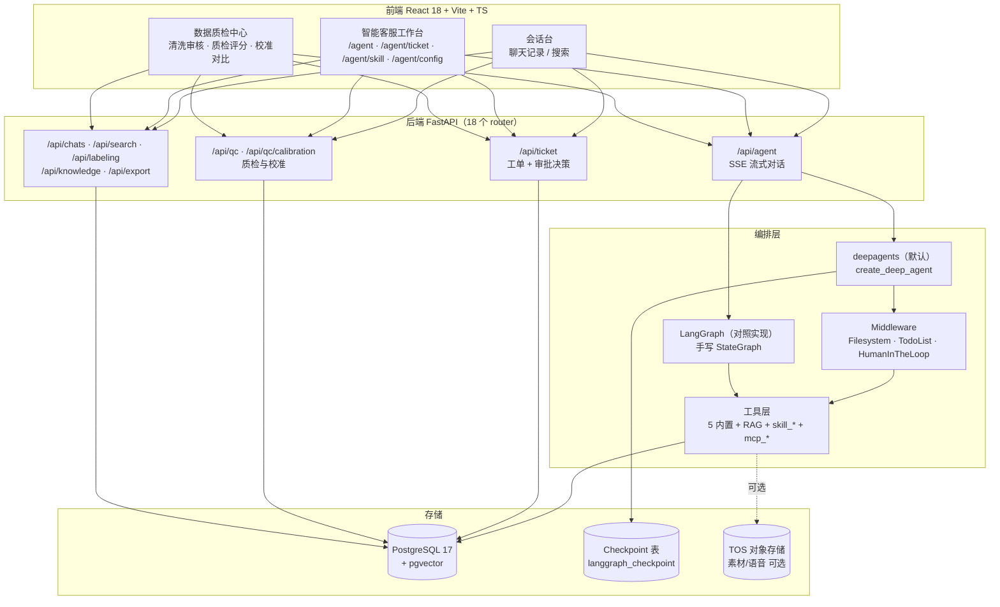

关键点：**编排层是可替换的**，工具层、工单、质检、数据流水线都不依赖具体引擎。切引擎只改一个环境变量。

---

## 3. 界面一览

以下截图均来自本仓库实际运行画面，对话与数据均为演示数据，不含真实客户信息。

**智能客服工作台**——客户发消息，Agent 识别意图、调用订单/物流/建单/退款工具，每轮回复带意图与情绪徽章；涉及退款的动作挂起等坐席审批：

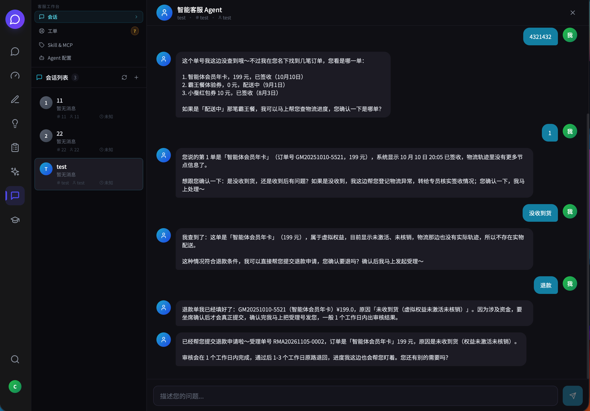

工单由 Agent 在对话中自动创建，与产生它的会话关联，坐席在同一工作台内接手：

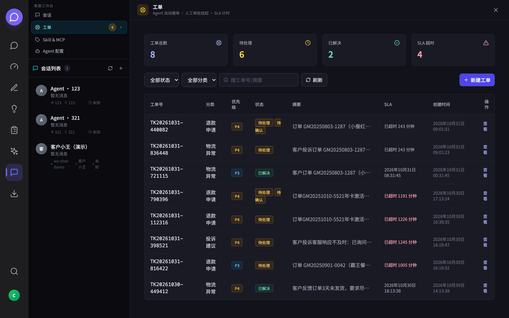

<details>
<summary><b>更多：Skill &amp; MCP 技能管理 / 子 Agent 与工具配置</b></summary>

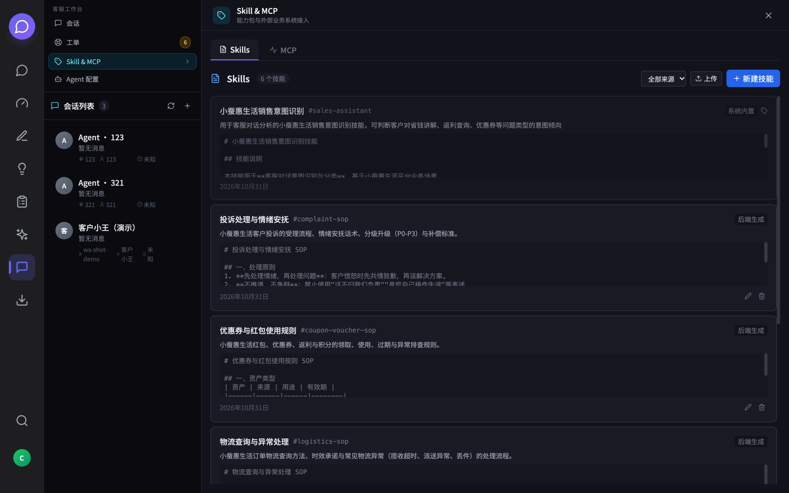

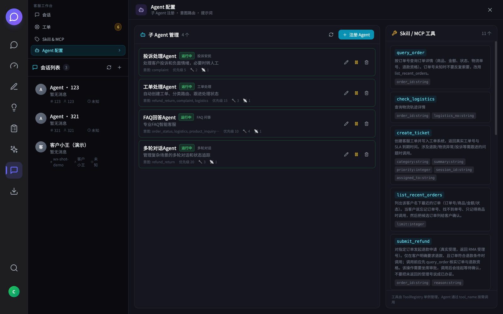

</details>

**数据质检中心**——离线侧的质检产线：会话清洗审核 → 批量质检评分 → AI 与人工标注的校准对比：

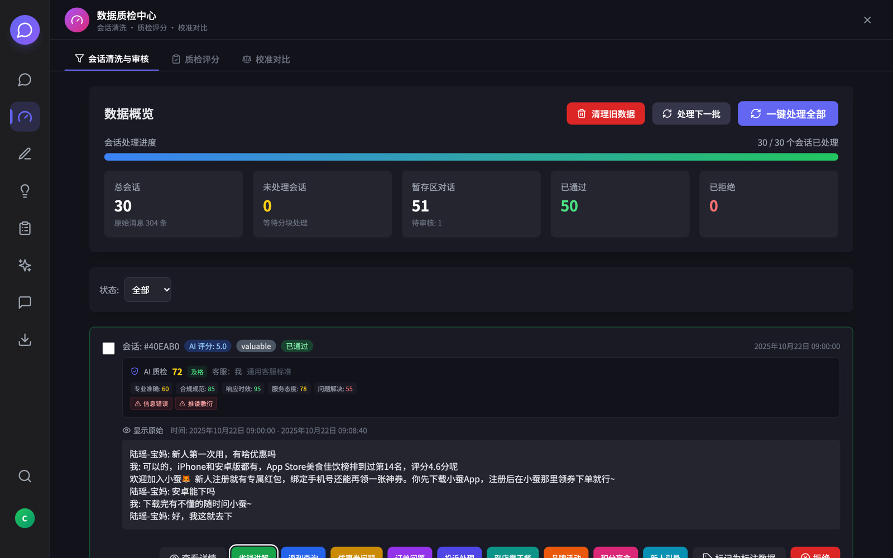

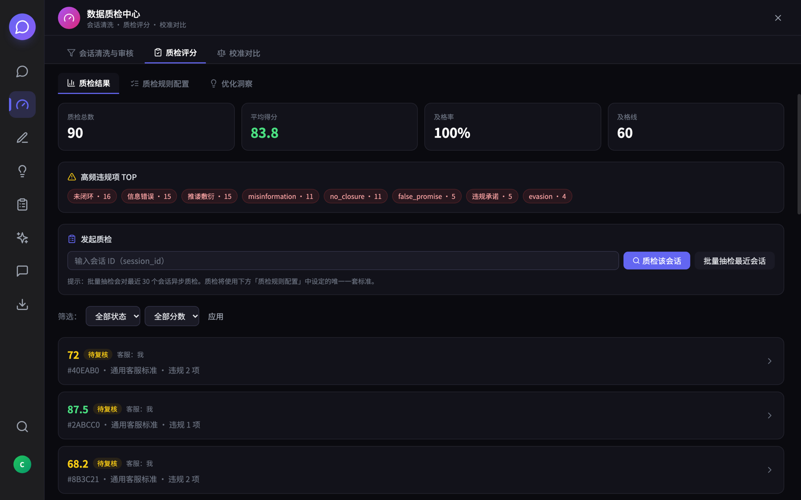

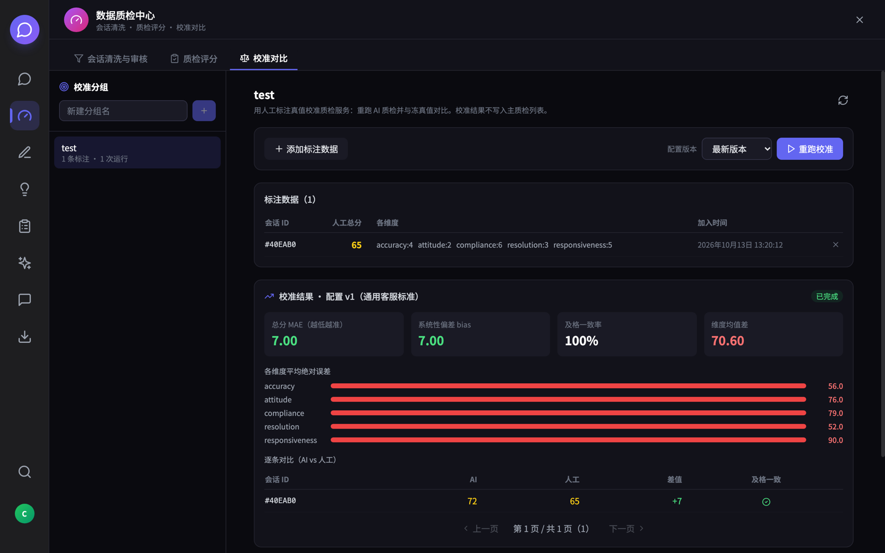

<details>
<summary><b>更多：会话台 / 全文搜索 / 智能助手 / 知识提炼 / 考核出题 / 数据管理 / 导出</b></summary>

会话台，聊天记录原文浏览：

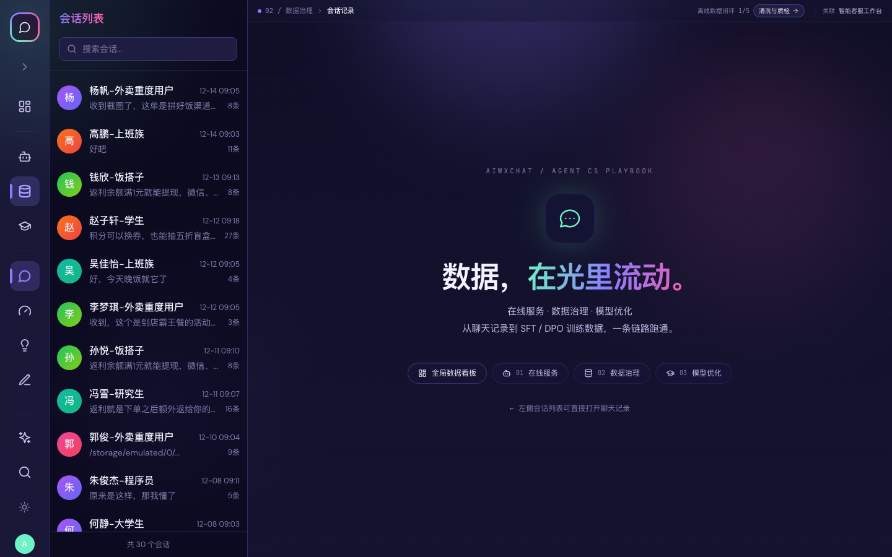

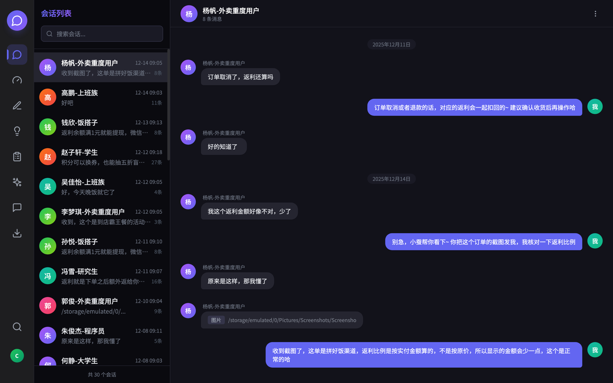

全文搜索聊天记录：

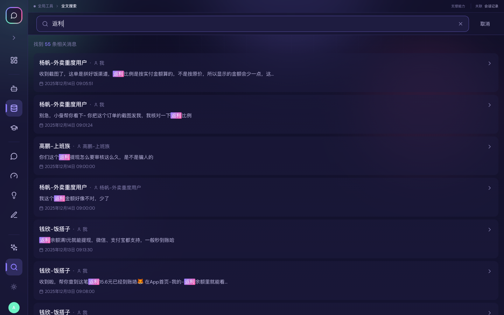

智能助手，基于历史对话的 RAG 问答，回答附带参考来源：

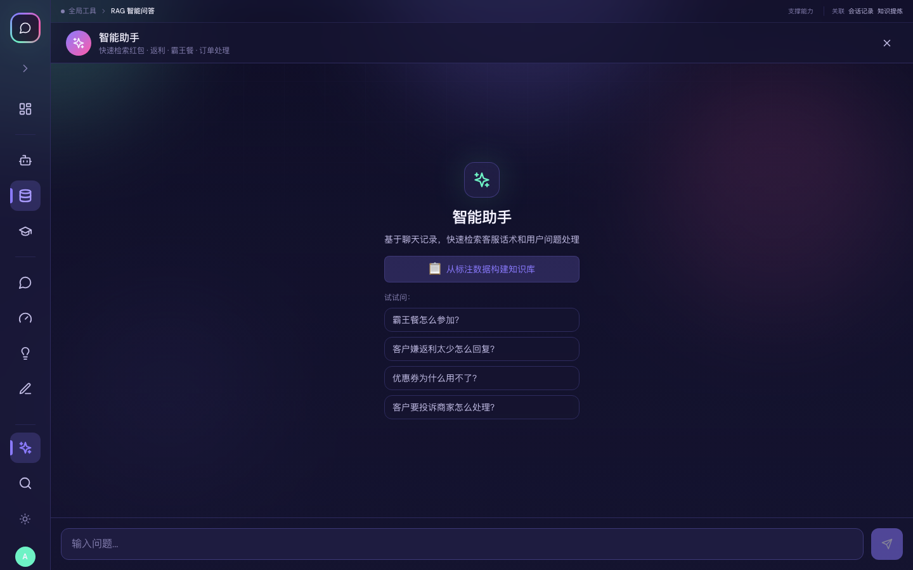

AI 知识提炼，从历史对话中提炼可复用的销售话术：

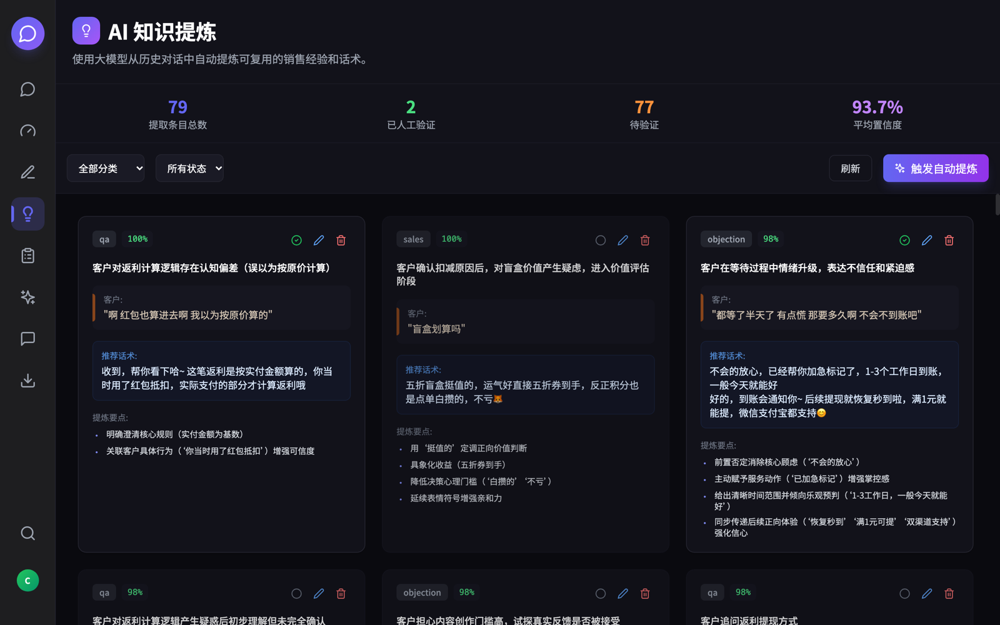

AI 考核，用标注数据自动出题组织客服实训：

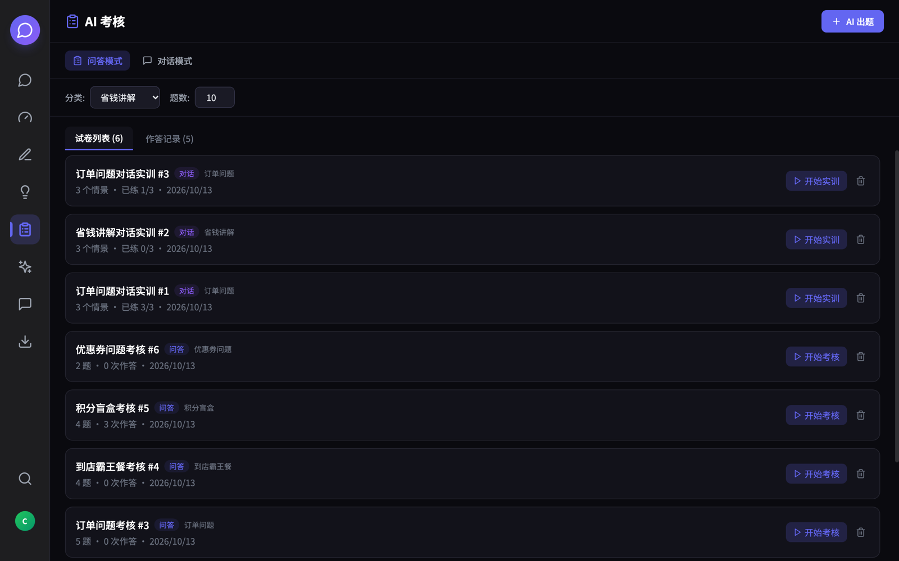

自定义对话数据管理与训练数据导出（ShareGPT / Alpaca / OpenAI / JSONL / RAG 知识库）：

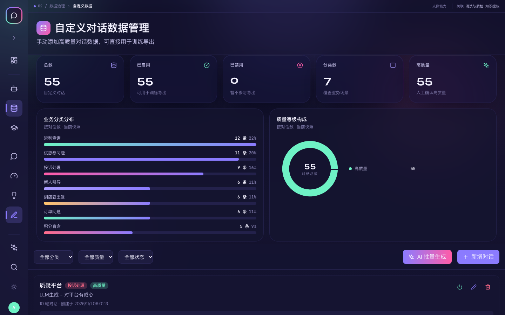

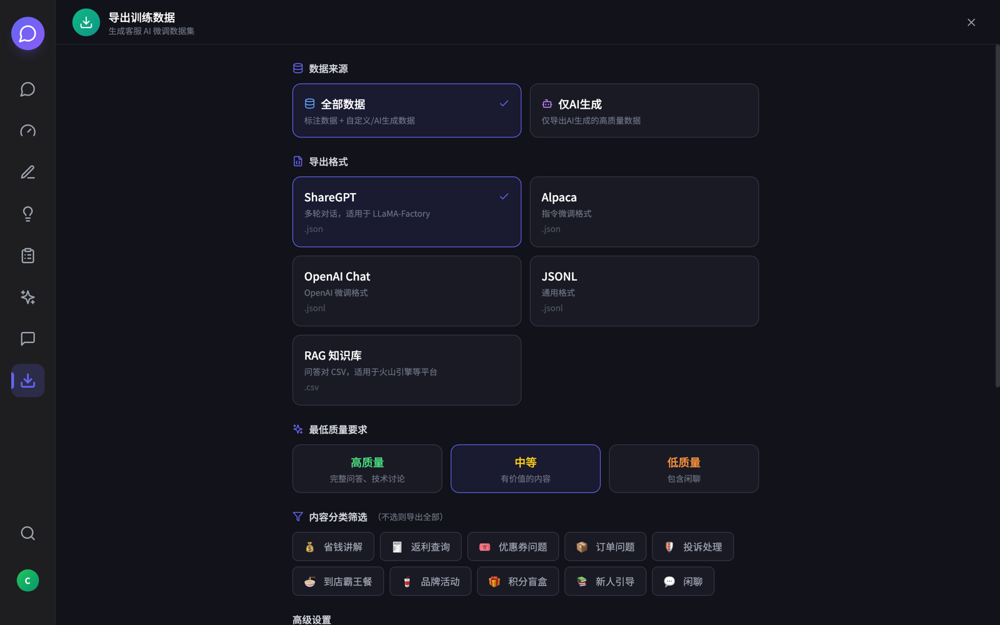

</details>

---

## 4. 一条消息进来之后发生什么

在线链路（`POST /api/agent/message/stream`，SSE）：

```
1  落库     AgentMessage(user) → 取/建 DialogState → turn_count += 1
2  渲染     状态 → prompt（阶段动作 + 已知槽位 + 共指实体 + 压缩后的历史窗口）
3  执行     图开始跑：意图识别 → 路由 → 工具调用 → 生成回答
4  判定     信号累积分：显式要人工 +3 / 敏感主题 +2 / 情绪强度≥4 +2 / 投诉且负面 +1
           / 置信度<0.4 +1 / 多轮拿不到关键信息 +1，满 3 分转人工
5  建单     满足条件 → 工单挂到 session，`pending_action` 记录上下文
6  闸门     若调用 submit_refund 且客户确实符合退款资格 → 中间件 interrupt()，图暂停
7  落盘     checkpoint 写入 Postgres，thread_id = "{session_id}:t{turn_count}"
8  返回     SSE done：{content, intent, emotion, needs_transfer, ticket, pending}
```

第 6 步是整条链路里唯一会"卡住"的地方，也是设计上最贵的一步，下面单独讲。

### 4.1 为什么一轮一个 thread

`thread_id` 不是会话 ID，而是 `session_id:t{turn_count}`。原因用一次对照实验说清楚：

| 策略 | 4 轮后 checkpoint 里的消息数 | 结论 |
| --- | --- | --- |
| 整个会话共用一个 thread | 2 → 4 → 6 → 8 | `messages` 是 `add_messages` 追加语义，`invoke` 是**合并**不是替换，历史线性膨胀 |
| 单 thread + 每轮传 2 条窗口 | 3 → 6 → 9 → 12 | 每轮重放窗口，重复叠加 |
| 每轮一个 thread | 2 → 2 → 2 → 2 | 恒定，且历史只属于这一轮 |

跨轮记忆交给 `dialog_states` + `agent_messages` 两张表，checkpoint 只负责"这一轮跑到哪了"。
职责分开，两边的数据都长得合理。

代价也很具体：**resume 必须落在同一个 thread 上**。用无断点的新 thread 调 `Command(resume=...)`
不会报错，而是另起一张空图再 interrupt 一次——`interrupts=1`、`messages=[]`、工具没执行，
一个静默失败的坑。所以挂起时把 `thread_id` 显式写进工单的 `pending_action`，续跑时从工单里取。

### 4.2 审批闸门：interrupt 在中间件里

```python
HumanInTheLoopMiddleware(
    interrupt_on={
        "submit_refund": {
            "allowed_decisions": ["approve", "reject"],
            "description": "退款受理（不可逆资金动作）",
            "when": _refund_needs_approval,   # 条件拦截：真的会动钱才停
        }
    },
    interrupt_mode="batched",
)
```

`when` 是这里的重点。无条件拦截会让每一次退款咨询都变工单，坐席被淹没；改成"订单存在且判定为可退"才停，闸门才只拦真正要花钱的那一下。

被拦下之后，`invoke` 是**正常返回**的（带 `__interrupt__`），不是抛异常。应用层接手做三件事：

1. 建/取工单，写入 `pending_action`（动作、金额、订单、thread_id、interrupt_id）
2. 生成给客户的话术——**确定性模板，不走 LLM**
3. 返回 SSE `done{ pending_approval: true, ticket }`

话术不走模型是有原因的：模型在中断前往往会说"我这就提交"，客户会当成已办妥；而工具根本没执行，
它也不可能知道"等待确认"这个状态；金额和单号更不能给它编造的空间。

坐席在 `/agent/ticket` 点批准 → `POST /api/ticket/{id}/decision` → 后端用工单里存的 thread_id
调 `Command(resume={"decisions": ["approve"]})` → 停住的节点**原地重放**，`interrupt()` 直接返回
决策值，`submit_refund` 才真正落库出 RMA 号。重复点批准返回 `already_decided`，幂等。

### 4.3 工具矩阵

| 来源 | 工具 | 说明 |
| --- | --- | --- |
| 内置 | `query_order` `list_recent_orders` `check_logistics` | 订单与物流，Mock 数据在 `order_store` |
| 内置 | `create_ticket` | 建单幂等：同会话同分类复用已有工单 |
| 内置 | `submit_refund` | **唯一挂审批闸门的工具**，失败不落库 |
| 内置 | `rag_knowledge` | 知识库检索，pgvector |
| 动态 | `skill_<id>` | 把 Skill 的 SOP 文本包成工具，模型按需取用 |
| 动态 | `mcp_<server>` | 挂载外部 MCP 服务，一个 server 聚合成一个入口 |

工具的上下文（`session_id` / `user_id`）由闭包注入，模型看不到也不需要传。

### 4.4 子 Agent 委派

`create_deep_agent(subagents=[...])` 注册了四个专业 Agent：投诉处理、工单处理、FAQ、多轮对话。
主 Agent 判断"这活儿不归我"时用 `task(subagent_name)` 委派，而不是在主 prompt 里堆 if/else。
每个子 Agent 的工具集独立配置，来自 `agent_configs` 表。

规划中间件（`TodoListMiddleware`）**按意图开关**：退款、投诉、物流异常这类多步流程打开，
单步查询关闭——客服是一问一答场景，每轮先写 todo 等于白烧一次 LLM 调用。

---

## 5. 离线数据闭环

质检和知识库不是凭空来的，源头是微信聊天记录：

```
微信 SQLite ──ETL──▶ raw_chats ──预处理──▶ staging_conversations ──人工审核──▶ labeled_conversations
                                                                          │
                     knowledge_articles / knowledge_chunks ◀──知识提炼────┘
                                  │
                                  ├──▶ pgvector 检索（RAG 工具）
                                  ├──▶ quality_inspections（质检评分）
                                  └──▶ 训练数据导出（ShareGPT / Alpaca / OpenAI / JSONL）
```

三个环节的设计取舍：

- **ETL 有时间下限**（2025-10-01 起），老数据不进库——历史话术分布和现在差太多，混进来污染知识库。
- **审核是硬闸门**：AI 只能把会话推进入 `staging`，进 `labeled` 必须过人。质检和训练数据都只吃 labeled。
- **校准单独存放**：`qc_calibration_*` 表只写不读主链路，避免"校准跑一次，线上质检统计全变"。

`数据质检中心` 的三个页签就是这条流水线的三段：**清洗审核 → 质检评分 → 校准对比**。

---

## 6. 领域模型

当前库 38 张表。`models/` 定义 28 张业务表，另外 10 张分三类，都不在 ORM 里：

| 类别 | 表 | 为什么不在 `models/` |
| --- | --- | --- |
| 服务内建表 | `dialog_states` · `refund_requests` | DDL 与读写都贴着业务写（状态快照 / 独立受理仓），拆成 ORM 反而要跟着结构改表 |
| 框架表 | `checkpoints` · `checkpoint_blobs` · `checkpoint_writes` · `checkpoint_migrations` | `langgraph-checkpoint-postgres` 自动创建，不要手工碰 |
| 历史遗留 | `materials` · `students` · `student_info_bindings` · `student_report_bindings` | 前身项目的素材与学生模块，当前代码已不读写，留着没删 |

28 张业务表按职责分五组：

| 分组 | 表 | 说明 |
| --- | --- | --- |
| 原始数据 | `contacts` `sessions` `raw_chats` | 微信导入的原始消息，只增不改 |
| 加工数据 | `staging_conversations` `labeled_conversations` `knowledge_articles` `knowledge_chunks` | 清洗、审核、切片、向量化 |
| Agent 运行 | `agent_sessions` `agent_messages` `intent_records` `emotion_records` `transfer_decisions` | 对话与决策留痕，质检和复盘的原料 |
| 工单 | `tickets` `ticket_events` | 工单本体 + 时间线；`pending_action` 是 JSON 列 |
| 质检 | `quality_inspections` `quality_inspection_configs` `qc_config_versions` `qc_calibration_*` | 评分、配置版本、校准分组与真值 |

`dialog_states.state_json` 存的是整个 DST 的序列化快照：四层槽位（意图 / 实体 / 画像 / 阶段）
+ 七阶段（`intake → info_gathering → diagnosis → solution → action → closing → escalation`）。
阶段的作用不是"让模型说什么"，而是"决定这一轮该做什么"——`INFO_GATHERING` 时只追问最关键的
一个缺失槽位，`SOLUTION` 时必须给出金额、时效、责任方，`ACTION` 才允许调执行类工具。

---

## 7. 技术栈

| 层 | 选型 | 备注 |
| --- | --- | --- |
| Web | FastAPI ≥0.109 · uvicorn · pydantic-settings | SSE 走 `StreamingResponse` |
| 编排 | `deepagents` 0.7+ · `langchain` 1.4+ · `langgraph` 1.2+ | 同一份工具与 prompt 契约喂两套引擎 |
| 断点 | `langgraph-checkpoint-postgres` | 挂起状态跨进程可恢复（重启后仍能批准） |
| 存储 | PostgreSQL 17 + pgvector · SQLAlchemy 2.0 · psycopg2 | 向量检索与业务表同库，少一套中间件 |
| 模型 | OpenAI 兼容协议 | LLM 用 DeepSeek，Embedding 用 DashScope，图片理解用火山方舟，都走兼容层 |
| 前端 | React 18 · Vite 5 · TS 5.3 · Tailwind 3.4 · react-router 6 · axios · zustand 5 | 全局态只有 MCP 健康轮询一处用 zustand，其余 `useReducer` + Context |
| 对象存储 | 火山 TOS（可选） | 素材库、语音文件 |
| 部署 | Docker Compose · nginx | `docker-compose.yml` 三容器；`docker-compose.db.yml` 只起库 |

不引入 ORM 迁移工具，启动时 `create_all` + `schema_sync` 兜底加列。**代价**是没有版本化迁移，
生产改表要手工。这是一个明确为了"clone 下来就能跑"做的让步。

---

## 8. 目录

```
backend/app/
├── main.py                  应用入口：建表、注册路由、Agent 预热
├── config.py                pydantic-settings，环境变量集中在此
├── routers/                 18 个 API 模块（agent / ticket / qc / chats / ...）
├── services/
│   ├── deep_agent.py        ★ deepagents 引擎：中间件栈、子 Agent、HITL、resume
│   ├── langgraph_agent.py   ★ LangGraph 引擎：StateGraph 手写实现，含转人工打分
│   ├── dialog_state.py      ★ DST：槽位、阶段、意图延续、共指消解
│   ├── intent_recognition.py  意图识别（词典初筛 + LLM 精判两级）
│   ├── ticket_service.py    工单全生命周期 + 审批挂起/决策
│   ├── refund_store.py      退款受理仓（RMA 号的唯一来源）
│   ├── tools/               工具基类、注册表、MCP 客户端
│   └── etl.py · quality_inspection.py · qc_calibration.py · ...  数据与质检流水线
└── models/                  SQLAlchemy 模型，28 张表

frontend/src/
├── App.tsx                  视图路由分发
├── appRoutes.ts             ViewMode / AgentPane 与 URL 的映射
├── api.ts                   全部接口的类型与调用
└── components/              AgentWorkbench / TicketView / QualityCheckView / QcCalibrationView / ...
```

想读 Agent 部分，顺序建议：`dialog_state.py`（状态长什么样）→ `deep_agent.py`（一轮怎么跑）
→ `ticket_service.py`（断在哪、怎么续）。

---

## 9. 运行

### 数据库

```bash
docker compose -f docker-compose.db.yml up -d      # PostgreSQL 17 + pgvector，映射 :5432
```

### 后端

```bash
cd backend
cp env.example .env                 # 至少填 DATABASE_URL、一个 LLM 的 API Key
uv sync
PYTHONPATH= ./.venv/bin/python -m uvicorn app.main:app --host 0.0.0.0 --port 8000
```

`PYTHONPATH=` 不是笔误：环境里如果有额外的 site-packages 注入，置空可以避免 `sitecustomize` 抢先加载。

### 前端

```bash
cd frontend
npm install
npm run dev                          # :3000
```

前端 `baseURL` 是 `/api`，由 vite 转发到 `frontend/vite.config.ts` 里的 `server.proxy['/api'].target`。
**这个值要和后端端口一致**——仓库里当前是 `http://localhost:8100`，而后端默认 8000，
如果你按上面的命令起后端，记得把这一行改成 8000，或用 `npm run dev -- --port <端口>` 配合调整。

### 端口一览

| 服务 | 默认 | 说明 |
| --- | --- | --- |
| 后端 | 8000 | `config.py` 的 `api_port`；docker 内同为 8000 |
| 前端 dev | 3000 | vite `server.port` |
| 前端容器 | 80 | nginx |
| 数据库 | 5432 | `docker-compose.db.yml` 映射到宿主 |

### 关于数据

仓库**不含**任何真实聊天记录。后端启动时 `create_all` 建表，空库即可跑通在线链路。
要灌演示数据，把脱敏后的 `pg_dump` 放 `docker/initdb/01-data.sql` 再重建卷
（该文件已在 `.gitignore` 中）。

---

## 10. 配置

| 变量 | 作用 | 默认 |
| --- | --- | --- |
| `DATABASE_URL` | PostgreSQL 连接串 | 见 `env.example` |
| `AGENT_ENGINE` | `deepagents` / `langgraph` | `deepagents` |
| `DEEPAGENTS_HITL` | 审批闸门总开关，`0` 关闭 | 开 |
| `DEEPAGENTS_TODOS` | 规划中间件，`1`/`0` 强制开关 | 按意图 |
| `DEEPSEEK_API_KEY` / `DEEPSEEK_BASE_URL` | 对话模型 | — |
| `ARK_API_KEY` / `ARK_EMBEDDING_MODEL` | Embedding（DashScope 兼容模式） | `text-embedding-v3` |
| `ARK_VISION_*` | 图片识别（学生信息批量导入，可选） | — |
| `WECHAT_DB_PATH` / `VOICE_FILE_PATH` | 微信数据源路径 | `../Msg/Msg` |
| `TOS_*` | 对象存储（素材库，可选） | — |
| `JWT_SECRET_KEY` | 令牌签名，**生产必须换** | 开发占位值 |

---

## 11. 主要接口

| 分组 | 端点 | 说明 |
| --- | --- | --- |
| Agent | `POST /api/agent/message/stream` | 流式对话，事件类型 `metadata/token/answer/done` |
| | `GET /api/agent/sessions` · `GET /api/agent/sessions/{id}/messages` | 会话列表与历史 |
| | `GET /api/agent/engine` · `POST /api/agent/intent/detect` | 当前引擎 / 单独试意图 |
| 工单 | `GET /api/ticket/list` | 支持 `status/category/keyword/session_id` 过滤 |
| | `POST /api/ticket/{id}/decision` | **审批：approve / reject**，触发 resume |
| | `GET /api/ticket/history/{session_id}` | 某会话的全部工单 |
| 质检 | `GET /api/qc/stats/summary` · `POST /api/qc/inspect` · `POST /api/qc/batch` | 评分、批跑 |
| | `POST /api/qc/{id}/review` · `GET /api/qc/config` | 人工复核、质检规则 |
| | `POST /api/qc/calibration/groups/{id}/run` | 用指定配置版本重跑并与真值对比 |
| 数据 | `GET /api/chats/sessions` · `GET /api/search` | 会话与全文检索 |
| | `POST /api/labeling/*` · `POST /api/export/*` | 标注与训练数据导出 |
| 能力 | `GET /api/skills/list` · `GET /api/mcp/servers` | Skill 与 MCP 管理 |

完整 schema 在服务启动后 `/docs`。

---

## 12. 已知限制

这些是明确没做的，别以为是 bug：

- **无双引擎等价性测试**。两套引擎共享工具与 prompt 契约，但输出没有逐字对齐，切换后话术会变。
- **无数据库迁移版本管理**。改表靠 `create_all` + `schema_sync` 补列，删列/改类型要手工。
- **Mock 业务系统**。订单、物流、退款仓是本地 Mock（`order_store` / `refund_store`），
  接真实系统要换工具实现，接口契约可复用。

---

## 13. 许可证与来源

- 代码：[Apache-2.0](LICENSE)，第三方资料边界见 [NOTICE](NOTICE)。
- 作者：[clearwind](https://github.com/clearwind)
