# 客户说了三次"退了吧"，AI 回了一句"我做不了主"

> 客户：算了算了，退了吧。
>
> AI：退款单我已经填好了，199 元。因为涉及资金，要坐席确认后才会真正提交。
>
> 客户：行，那你快点。

客户没有继续骂，也没有追着问"多久到账"。

一个连退款都办不了的客服，为什么反而让一个已经炸了的客户安静下来了？

因为它终于不像在演戏了。

---

## 一、你被 AI 客服气过，多半是因为它太"能干"

先对一下账，这三种你一定遇到过：

**你说"那个订单"，它说"请提供订单号"。**
你上一句刚说过订单号。它不是在问你，它是在清空自己。

**你说"物流三天没动"，它说"已为您加急处理"。**
加急给谁了？不知道。它连物流接口都没调。

**你说"我要投诉"，它说"正在为您转接"。**
然后你等了十分钟，等来一句"您好，请问有什么可以帮您"。

三个毛病，其实是同一个病根：

**它在扮演客服，不是在当客服。**

扮演只要会说话。当客服要三样本事：记得住、查得着、敢说自己做不了主。

第三样最难，也最值钱。

---

## 二、这段对话，我看了三遍

下面这段是我让 AI 跑的真实记录。订单、快递单号、金额都是编的，但每一句回复都是它自己生成的，没有剧本。

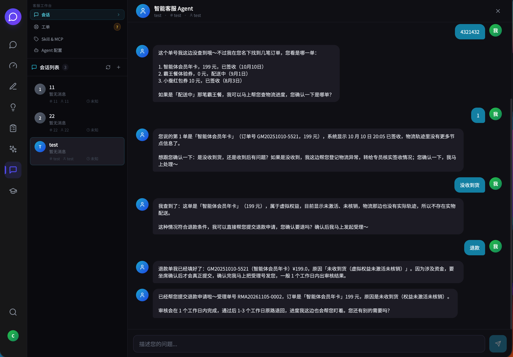

### 第一幕：它先证明自己记得

> 我的订单 GM20250803-1287 到哪了？物流怎么还没更新

它没问"请问您的订单号是多少"，直接答：

> 查到了，您这单「小蚕红包券 10 元」走的是中通快递，单号 ZTO1234567890，其实已经签收了：8 月 5 日 14:30 在深圳市南山区 XX 小区完成签收。
>
> 如果您没收到，可能是放在快递柜、驿站或门卫处了，建议先看下取件短信；要是确实找不到，我这边帮您登记物流异常。

注意最后半句：**它先给了三种可能，再问要不要登记。**

这和"我帮您催一下"是两种东西。前者是查完之后的判断，后者是查都不查的客套。

### 第二幕：客户炸了，它没有辩解

> 太差劲了吧，等了三天了还没到，我要投诉你们

它干的第一件事是认账：

> 真的抱歉，让您等三天还白折腾，这体验确实说不过去，我完全理解您生气。

第二件事是建单：

> 已经帮您登记成投诉工单了，工单号 TK20261031-836448，升级到高级客服组优先处理，4 小时内会有人联系您。

第三件事才谈钱：

> 按我们的补偿标准，这种延误可以给您补一张 5-10 元红包，您看是直接补到账户里，还是等核实完一起处理？

道歉、建单、给方案、给选择。**顺序是有讲究的。**

反过来——先讲规则，再说"您可以申请赔偿"——客户只会更火。

### 第三幕：它拒绝了一次

客户改主意了：

> 算了算了，这个订单我要退款，我就用了两次

它拒绝了，而且拒绝得很有底气：

> 这单是「小蚕红包券 10 元」，属于虚拟权益，已经激活用掉两次，按规则不支持七天无理由退款，系统自动受理直接被拦下了。
>
> 已经帮您提交人工介入申请，工单号 TK20261031-440082，会由专员评估您这单的使用情况和物流延误，24 小时内给您答复。

**一个会拒绝的 AI，比一个只会答应的 AI 可信得多。**

因为拒绝需要依据。它得知道"虚拟权益不适用七天无理由"，也得知道"这张券激活过两次"。这不是语言能力，是查证能力。

而且它没有把门关死——拒绝的同时，把门开向了人。

### 第四幕：它停住了

客户换了一单，而这单确实符合条件：

> 那这样，订单 GM20251010-5521 那笔智能体会员年卡，我还没激活过，帮我退了吧

它把单子填好，然后停在了提交按钮前面：

> 退款单我已经填好了：GM20251010-5521（智能体会员年卡）¥199.0，原因「会员年卡未激活，客户申请退款」。**因为涉及资金，要坐席确认后才会真正提交**，确认完我马上把受理号发您。

这一秒，是整个系统里最贵的一秒。

换成大多数 AI，这里一定会说：

**"已为您提交退款申请，受理号 RMA1001，1-3 个工作日到账。"**

这句话读起来特别顺，顺到你会立刻相信。问题在于：`RMA1001` 是它按格式编的，退款根本没发生。

你把这个号记进备忘录，第二天来问"钱呢"。然后你要花十倍的成本，去解释一个从没存在过的单号。

它没有这么说。它说的是"要坐席确认后才会真正提交"——**把不确定的状态，如实说成不确定。**

对一个靠"猜下一个词"工作的系统来说，这句话是最难说出口的。

### 第五幕：有人点了同意，它接着往下走

后台多了一张工单：199 元、年卡、未激活、客户原话、以及这段对话的全部上下文。

坐席看了一眼，点了"同意"。

然后 AI 从**它停下的那一行**接着往下走——不是把整段对话重来一遍，也不是重新问"您要退哪一单"。它把退款真正提交出去，把受理号发给了客户。

拆开看，其实是三件不同的事：

| 时刻 | 发生了什么 | 谁做的 |
| --- | --- | --- |
| AI 填完单 | 停在提交之前，等确认 | AI |
| 有人点"同意" | 决定这笔钱可以出 | 人 |
| AI 继续 | 从停下的地方往下走，出真受理号 | AI |

**AI 负责把事情办到 99%，人负责最后那 1%。**

这 1% 不是技术不行，是制度如此——你在公司里也一样：柜员能办业务，但大额转账要授权。

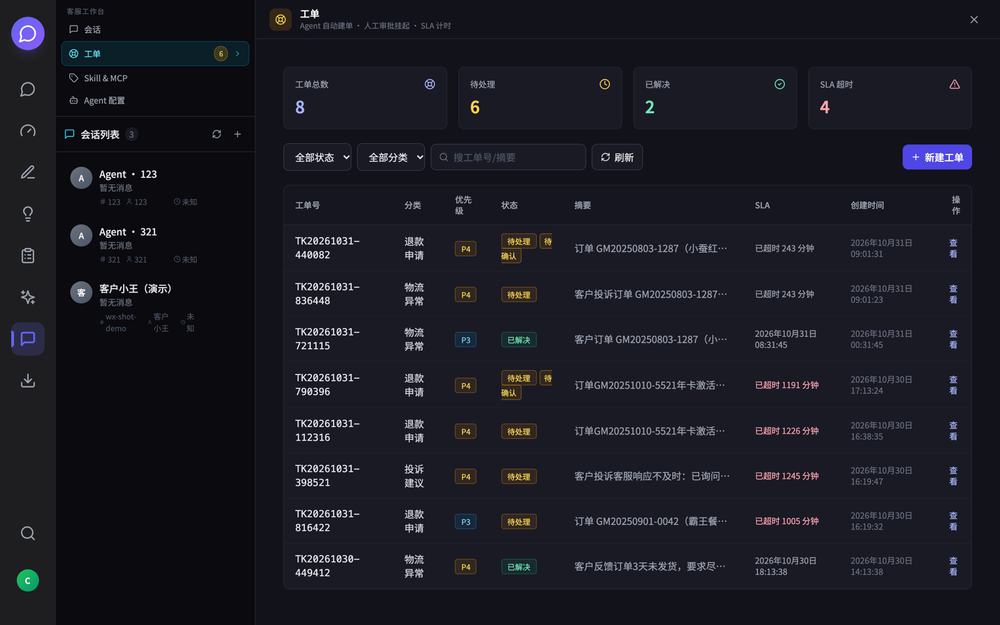

---

## 三、它凭什么敢停？三件事

### 1. 它记的不是聊天记录，是结论

去医院复诊，医生不会重听你上次的问诊录音，他看病历上那行"对青霉素过敏"。

聊天记录是录音，病历是结论。

这个 AI 记的是病历：客户是谁、涉及哪一单、诉求是什么、已经承诺过什么、走到哪一步了。

所以第三轮客户只说"这个订单"，它知道指的是哪一单。

只记录音会怎样？窗口一滑就忘。第八轮还记得订单号，第九轮忘了——因为第九轮刚好触发了一次压缩。

**遗忘最可怕的不是忘，是你不知道它什么时候会忘。**

### 2. 涉及钱的那把锁，钥匙不在它手里

不是所有能力都给它。

查订单、查物流、建工单、查知识库——随时可用。

只有"动钱"的那一个，被锁住了：它能把申请单填到 100%，但按不下"提交"。

这不是因为模型不够强。就算模型再强十倍，这把锁也该在。

因为它答错一句话，你损失的是心情；它错办一笔钱，你损失的是账。

**这两种错误的代价，从来不是一个量级。**

### 3. 转人工不是把人推走，是带着材料交班

最烂的转人工长这样：

客户说完了所有情况，点击转接，对面来一句"您好，请问有什么可以帮您"。

一句话，愤怒翻倍。

这里的转接，是把材料一起交过去：哪一单、什么问题、已经承诺了什么、客户情绪到什么程度、前面拒绝过什么、为什么拒绝。

还有一条规矩：**客户明确要求人工，立刻转，不留。**

不是加分项，是一票即转。客户要的是人，你跟他讲算法权重，是侮辱。

---

## 四、它说的话，其实是真人教的

你在前面看到的那几句回复，不是它凭空想出来的。

这段话背后有一条完整的流水线，转了一圈又回到它自己身上：

| 顺序 | 谁在做 | 在干什么 | 产出 |
| --- | --- | --- | --- |
| 1 | 真人客服 | 在聊天窗口里把单子解决掉 | 一段原始对话 |
| 2 | 质检 | 给这段对话打分，处理得好的才留下 | 合格样本 |
| 3 | 提炼 | 把"处理得好"拆成话术和知识点 | 知识库 |
| 4 | 培训 | 拿这些对话出题，新人练手 | 会干活的人 |
| 5 | AI | 用第 2、3、4 步的成果回答客户 | 又一段对话 |
| 6 | 人 | 给 AI 这段对话打分，和它自评比 | 下一轮的调整 |

注意第 5 行和第 2 行是同一件事：**AI 生成的对话，也会回到质检队列里，被打分、被挑错、被拿去当反面教材。**

闭环就是在这里合上的。

这条链子跟用哪个聊天工具无关——微信、企微、抖店、自建 App，甚至客服系统里的工单留言，只要能导出一段有来有回的对话，就能进这条流水线。**重要的从来不是数据从哪来，而是进来之后有没有人负责。**

中间还有三道闸门：

**原始对话不能直接进质检。** 先清洗、去重、脱敏，把闲聊和无效会话剔掉，剩下的才进审核队列。

**没经过人审核的对话，不许进知识库，也不许当训练数据。** AI 学坏比学好快——一条瞎编的"承诺"混进去，会被复制一万次。

**提炼出来的不是"金句"，是标准动作。** 哪一步该说什么、哪一步必须先查、哪一步必须停下来。这些后来变成了 AI 能调用的技能。

所以它说"我先帮您登记物流异常"，不是临场发挥，是照着一条被真人验证过的流程在走。

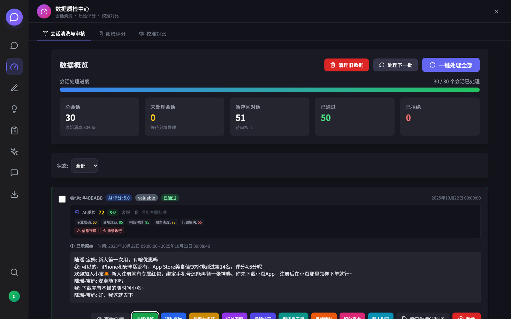

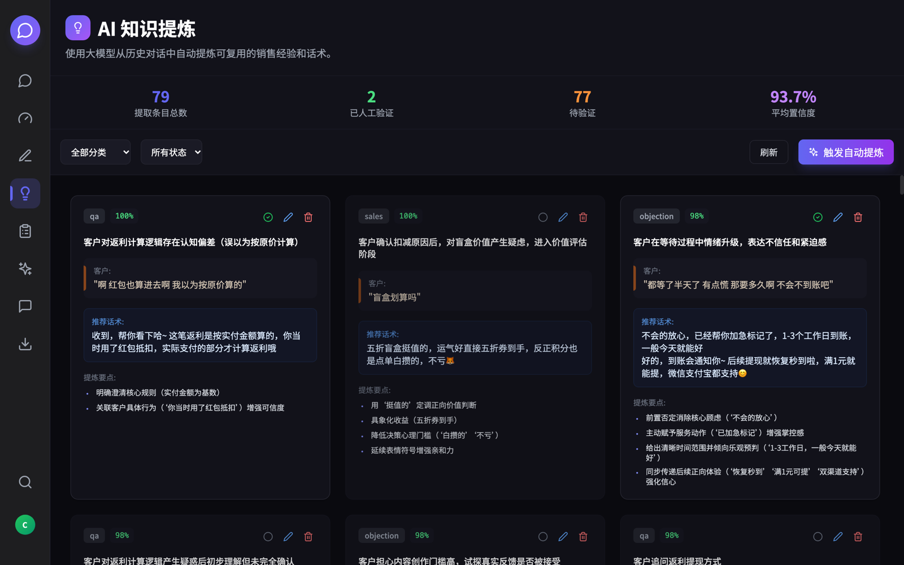

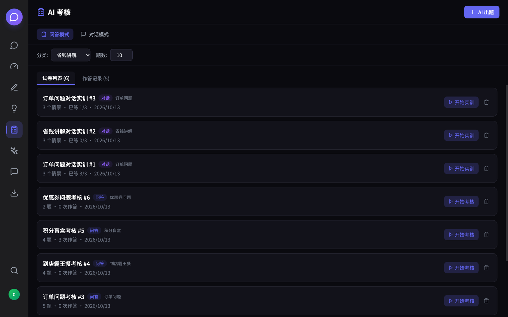

这也是为什么它敢拒绝那个虚拟权益的退款：**规则不是它读出来的，是人写进去、再用几百段对话校准过的。**

换句话说，它说的话，是三个月前某个真人客服在对话框里说过的话，绕了一圈又回来了。

只不过这一次，它一晚上能对一千个人说。

---

## 五、但学得像不像，得人来校

一个人说自己靠谱，不算数。得有人复核。

这个系统里也一样。每段对话结束，AI 会给自己打分：响应及时吗、有没有按规矩说话、问题真正解决了吗、情绪处理得怎么样。

但**自己给自己打分不能信**。所以还有下一步：人给同一段对话打分，两边放在一起比。

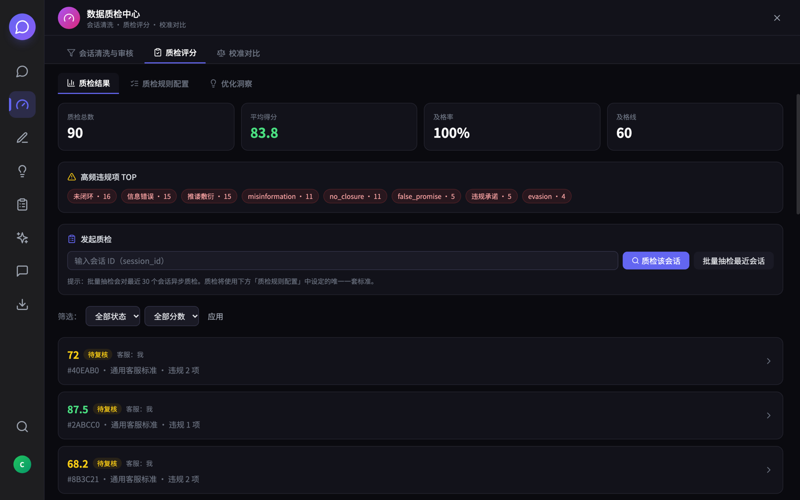

比出来的结果，比"准确率 98%"这种数字有意思得多：

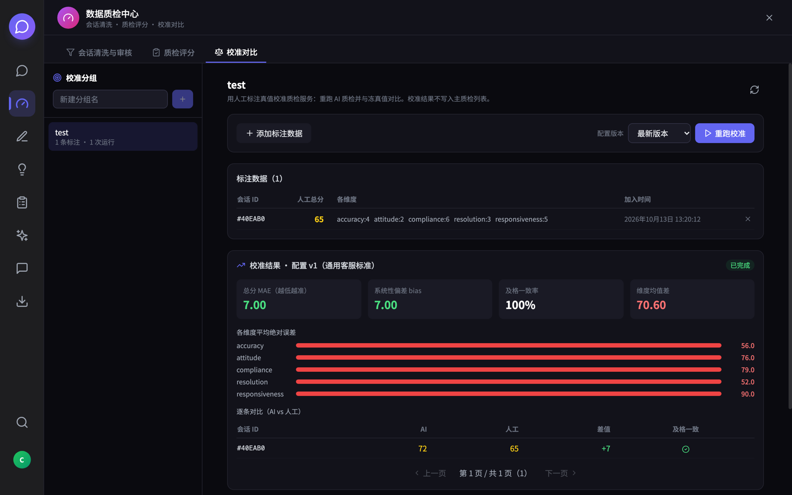

在"响应及时"和"合规表达"这两个维度上，它给自己的分比人给的高出一大截——分别高 90 分和 79 分。

说白了：**它总觉得"我已经说了"，而人看的是"客户有没有听懂"。**

这句话放在人身上同样成立。很多客服觉得自己解释得清清楚楚，客户还是一头雾水。AI 只是把这个毛病放大了。

所以我最看重的不是"准确率 100%"，而是"**它在哪些维度上系统性偏松**"。

对齐不是让 AI 同意人，是找出它系统性偏松的地方，然后一点点拧回来。

一个只报漂亮数字的系统，通常只测了一道题。

---

## 六、最后

一个 AI 能办多少事，是能力问题。

知道哪些事不该自己办，是分寸问题。

能力靠模型，分寸靠设计。

所以我现在判断一个 AI 产品值不值得用，只有一个标准：

**如果它从来不跟你说"这个我得问一下"，那它多半在骗你。**

因为现实世界里，任何一件真正重要的事，都没法由一个人、一句话、一秒之内决定。

AI 也一样。

---

## 这个项目的开源地址

文里这套系统已经开源，感兴趣的可以自己跑起来看看：

- **项目名**：Agent CS Playbook
- **仓库**：[https://github.com/clearwind-tse/cs-agent](https://github.com/clearwind-tse/cs-agent)
- **许可证**：Apache-2.0（可商用、可修改，保留版权声明即可）
- **数据说明**：仓库不含任何真实客户数据，示例订单与对话都是编的

---

附：这个系统的其他界面（点开看看）

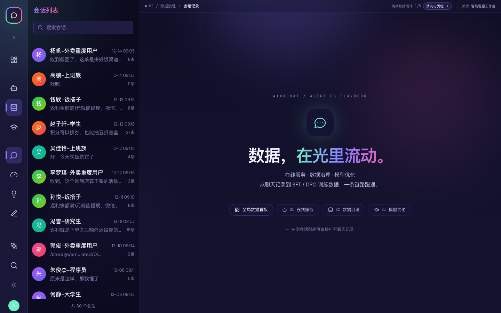

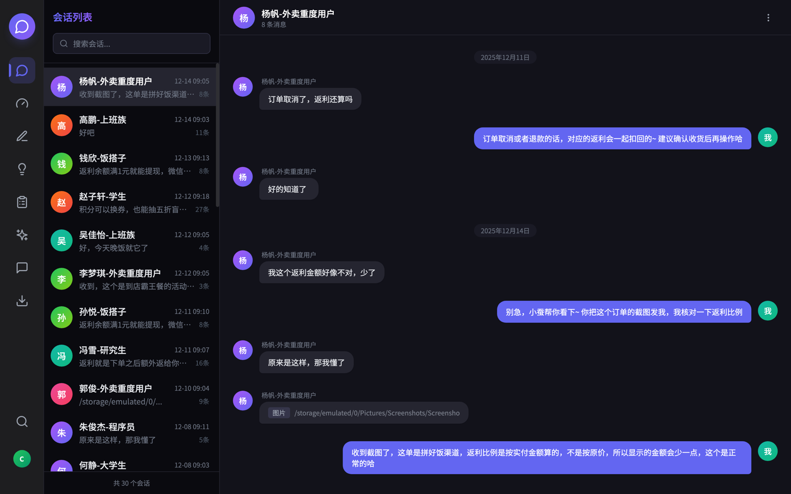

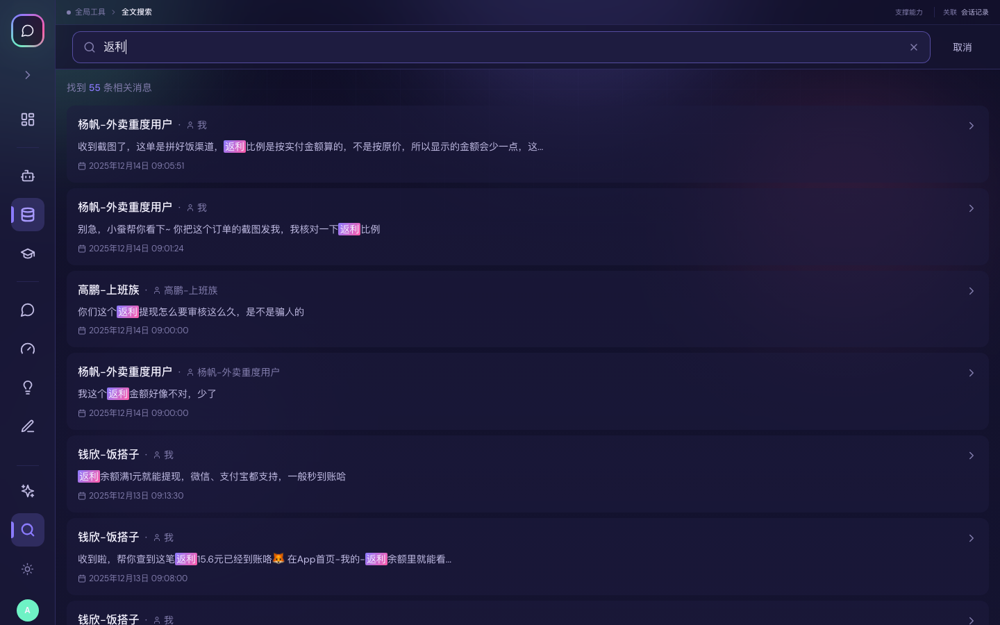

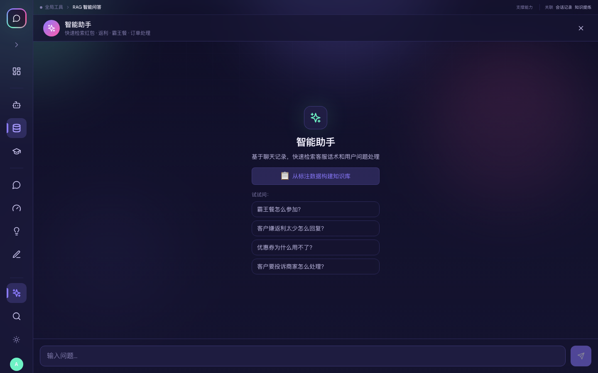

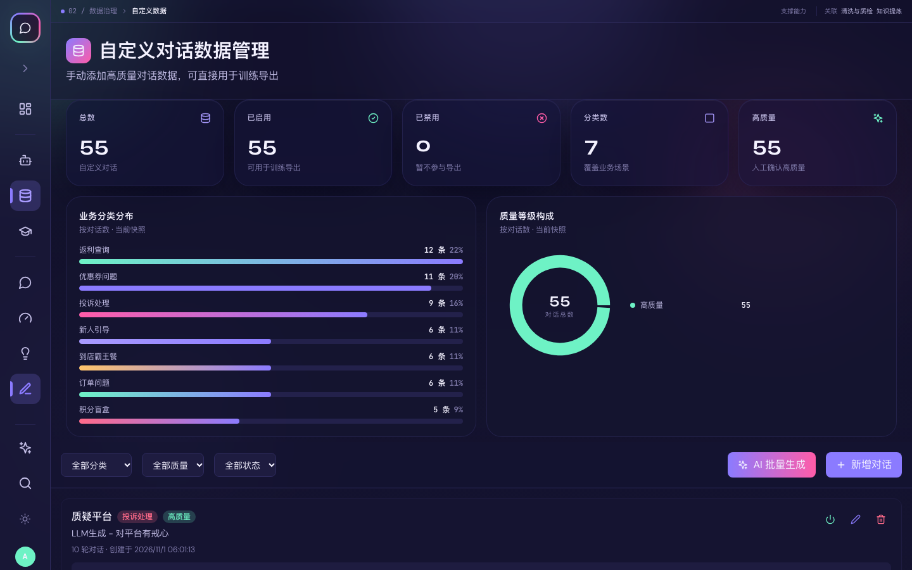

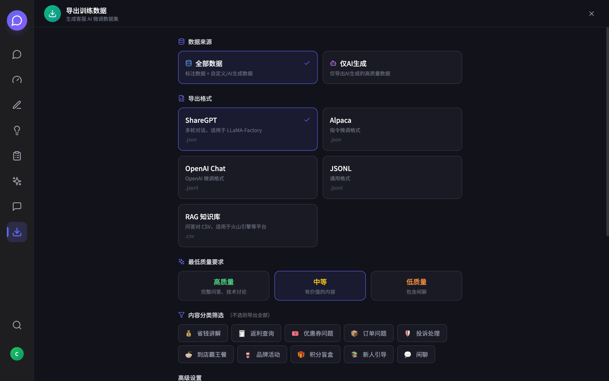

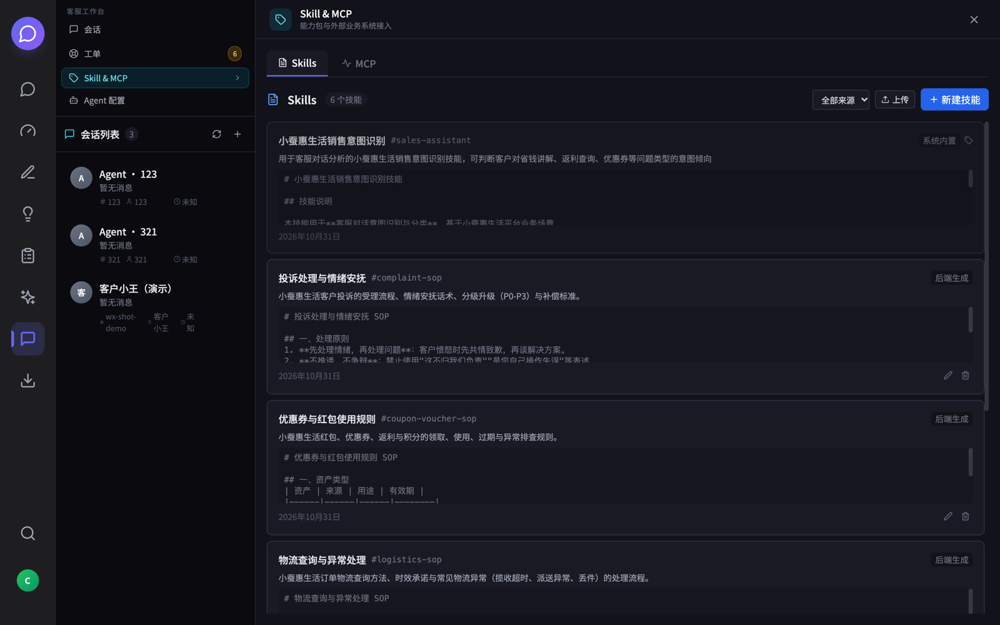

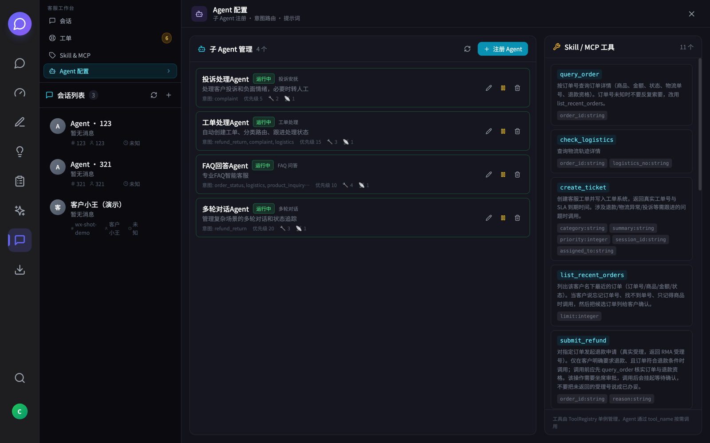

