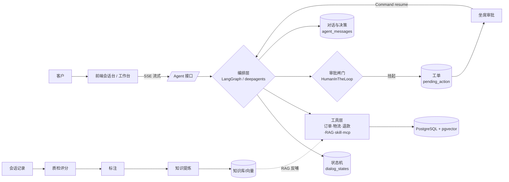
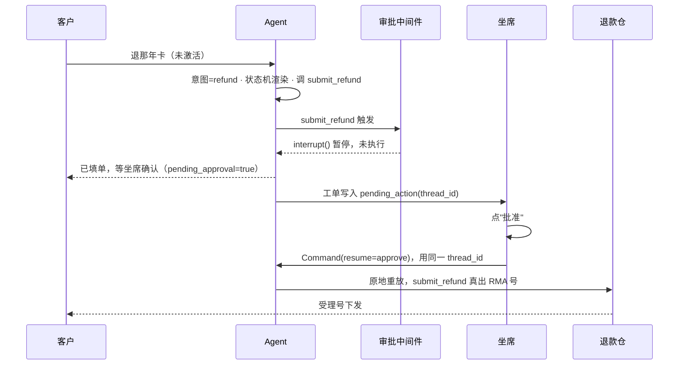

# 客服 Agent 实战：从意图识别到自动工单闭环

> 一套能"在钱面前停下、等人签字、再原地续跑"的客服 Agent 是怎么搭起来的

---

## 为什么写这篇

先讲一个几乎所有做客服自动化的团队都会遇到的场景：

某电商平台做了一次盘点——平均工单响应时长 48 小时，15% 的客户在等待中直接流失，人工坐席 70% 的时间被"我的快递到哪了""退款什么时候到账"这类重复问题吞噬。团队试过 FAQ Bot，结果机器人**自信地编造退货政策**，愤怒的客户截图发到群里。

这不是段子，是行业常态。问题不在于"模型不够强"，而在于**把对话变成可担责的业务动作，需要一套结构，而不是一个更聪明的模型**。

本文顺着这条链路，从一个真实项目的实现，讲清楚三件事：

1. 客服 Agent 为什么会在四个地方"做不下去"
2. 每个地方，我们用什么结构兜住
3. 那条最贵的"暂停键"——资金类动作的人工审批闸门——到底怎么落地

---

## 一、客服自动化的四个阶段

回顾一下这个领域的演进，便于理解我们站在哪：

| 阶段 | 时间 | 代表做法 | 天花板 |
| --- | --- | --- | --- |
| 决策树 Chatbot | 2015–2020 | 关键词 + 流程图 | 答非所问，维护地狱 |
| RAG + LLM | 2022–2024 | 检索增强 + 大模型生成 | 能聊，但**不记事、不担责** |
| Agent 网格 | 2024–至今 | 多 Agent 分工 + 工具调用 | 能办事，但**缺审批与闭环** |
| Agentic AI + MCP | 2025–未来 | 自主规划 + 外部工具即插即用 | 仍在补课"可控"这件事 |

我们的实现落在第三阶段，并重点补上了第四阶段最稀缺的一块：**不可逆动作的Human-in-the-Loop（人在环）闸门**。

---

## 二、四个"为什么做不下去"

教科书里把客服 Bot 的失败归因成四个痛点。我们逐一对照，看工程上怎么解。

### 痛点一：幻觉严重——"一本正经地胡说八道"

最危险的一类，是模型**编出业务凭证**。客户问退款进度，它回"受理号 RMA1001 已提交"——这个号根本不存在。

**我们的解法是：凭证唯一来源 + 白名单校验。**

退款受理号（`RMA`）只由真实的退款仓 `refund_store` 生成，工具拿到号后先做正则白名单校验，不匹配直接判为幻觉、失败不落库。模型可以"复述"单号，但**单号的诞生它无权伪造**。

### 痛点二：多轮对话断裂——"它又问了我一遍"

滑窗历史一压缩，客户第八轮说的订单号，第九轮就忘了。

**我们的解法是：对话状态机（DST）是唯一真相源。**

每轮 prompt 不是"历史拼接"，而是由状态渲染：

```
阶段动作 + 已知槽位 + 共指实体 + 压缩后的历史窗口
```

订单号、金额、责任方、当前阶段（七阶段之一）都序列化在 `dialog_states.state_json` 里。状态一旦写入，**不可能因为窗口滑动而消失**。客户说"那个年卡"，系统能解析出具体订单，因为它记在状态里，不在聊天记录里。

### 痛点三：工单系统断裂——"对话归对话，工单归工单"

建单是旁路写库，坐席打开工单时不知道客户刚说了什么。

**我们的解法是：工单挂在 `session_id` 上。**

Agent 在对话中调 `create_ticket`，同会话同分类幂等复用；挂起动作把 `thread_id` 钉进工单的 `pending_action`。坐席打开工单，看到的是这一单的完整来龙去脉，而不是一个孤零零的标题。会话侧边栏每个会话都有"查看本会话工单"的入口。

### 痛点四：转人工策略失控——"要么全转，要么不转"

关键词命中即转，客户问题一个没解决就被推走；或者永远不转，情绪崩了还在硬撑。

**我们的解法是：多信号累积打分。**

| 信号 | 分值 |
| --- | --- |
| 显式要人工 | +3 |
| 敏感主题（资金/人身/监管） | +2 |
| 情绪强度 ≥ 4 | +2 |
| 投诉且情绪负面 | +1 |
| 置信度 < 0.4 | +1 |
| 多轮拿不到关键信息 | +1 |

满 3 分才转。显式要人工一票即转——这是客户的权利，不该被算法挽留。其余信号攒够才转，且转接时把已登记信息一并交接。

---

## 三、核心能力落到代码上

教科书写"客服 Agent 的六大核心能力"，落到这个项目里，最硬核的是两个：**状态驱动的意图/情绪识别**，和**资金动作的审批闸门**。

### 3.1 识别不是分类，是路由的依据

意图识别、情绪判定、转人工打分，三者在每一轮都跑一遍，结果写进状态，并随 SSE 流回前端：

```json
{
  "content": "...",
  "intent": "refund_return",
  "confidence": 0.95,
  "emotion": "焦虑 · 2/5",
  "needs_transfer": false,
  "ticket": "TK20261031-440082",
  "pending_approval": true
}
```

`pending_approval: true` 意味着：这句话之后，图**暂停**了。

### 3.2 最贵的那一行配置

审批闸门不在提示词里，在编排中间件里：

```python
HumanInTheLoopMiddleware(
    interrupt_on={
        "submit_refund": {
            "allowed_decisions": ["approve", "reject"],
            "description": "退款受理（不可逆资金动作）",
            "when": _refund_needs_approval,   # 条件拦截：真的会动钱才停
        }
    },
    interrupt_mode="batched",
)
```

`when` 是全部重点。**无条件拦截**会让每一次退款咨询都变工单，坐席被淹没；改成"订单存在且判定为可退"才拦，闸门才只拦真正要花钱的那一下。

被拦下后，`invoke` 是**正常返回**（带 `__interrupt__`），不是抛异常。应用层接手三件事：建/取工单 → 用确定性模板生成"等待确认"话术（**不走 LLM**，模型在中断前往往已说"我这就提交"，客户会当成已办妥）→ 返回 `done{pending_approval: true}`。

---

## 四、全流程业务讲解与数据流图

先跳出代码，看一条客户消息在系统里是怎么流动的。在线与离线两条主线共用同一套后端与数据模型。



对应到业务时序，一条消息进来走完这八步：

1. **落库**：客户消息写入 `agent_messages`，状态机取/建 `dialog_states`，轮次 +1
2. **渲染**：状态 → prompt（阶段动作 + 已知槽位 + 共指实体 + 压缩后的历史窗口）
3. **执行**：编排层跑「意图识别 → 路由 → 工具调用 → 生成回答」
4. **判定**：多信号打分，显式要人工 +3 / 敏感 +2 / 情绪≥4 +2 / 投诉负面 +1 / 置信度<0.4 +1 / 多轮拿不到 +1，满 3 分转人工
5. **建单**：满足条件 → 工单挂到 `session_id`，`pending_action` 记录上下文
6. **闸门**：若触发 `submit_refund` 且客户确实符合退款资格 → 中间件 `interrupt()`，图暂停
7. **续跑**：坐席在 `/agent/ticket` 点批准 → 后端用同一 `thread_id` 调 `Command(resume)` → 节点原地重放，`submit_refund` 真出 RMA 号
8. **反哺**：离线侧会话 → 质检 → 标注 → 提炼 → 知识库，再以 RAG 形式回到工具层第 3 步

第 6、7 步是在线侧的**审批闭环**，第 8 步是离线侧的**数据闭环**——两条线都指向同一份数据、同一套人负责，这也是前面四个痛点能在一个系统里被同时兜住的原因。

---

## 五、一个真实的闭环时刻

把上面所有结构串起来，看一笔退款是怎么从"客户说退"走到"钱真的退"的：



关键在最后两步：**resume 必须落在同一个 `thread_id` 上。**

我们用 `thread_id = "{session_id}:t{turn_count}"`，每轮一个 thread，跨轮记忆交给 `dialog_states` + `agent_messages`，checkpoint 只管"这一轮跑到哪了"。

代价很具体：用一个新的空 thread 去 `Command(resume=...)` 不会报错，而是静默地新起一张空图再 interrupt 一次——`interrupts=1`、`messages=[]`、工具一次没执行。这是个典型**静默失败**，所以 `thread_id` 被显式写进工单，续跑时从工单里取，从不"猜"。

---

## 六、离线那条线：对话怎么反哺 Agent

在线链路解决"这次怎么回"，离线链路解决"下次怎么回得更好"。一条完整的闭环：

```
真人客服在聊天窗口解决单子
   → 质检打分，处理得好的才留下
   → 提炼成话术与知识点（知识库）
   → 用这些对话出题，培训新人
   → AI 用上述成果回答客户（RAG + skill_ 工具）
   → 人再给 AI 的回答打分，和 AI 自评对比校准
```

这条链子跟用哪个聊天工具无关——微信、企微、抖店、自建 App，只要能导出一段有来有回的对话，就能进这条流水线。**重要的从来不是数据从哪来，而是进来之后有没有人负责。**

其中"校准"是容易被忽略的一步：AI 在"响应及时""合规表达"两个维度上，自评比人评高出 90 分和 79 分——它总觉得"我已经说了"，而人看的是"客户有没有听懂"。对齐不是让 AI 同意人，是找出它系统性偏松的地方，再拧回来。

---

## 七、两个常见误区

> **误区一：上了 LLM 就能解决所有客服问题。**
> 模型负责"能说"，结构负责"可信"。没有状态机、没有审批闸门、没有工单闭环，模型越强，闯的祸越大。

> **误区二：追求 100% 自动化率。**
> 真正的指标不是"多少单没转人工"，而是"转人工时带没带齐上下文"和"自动处理的单子里有没有幻觉"。一个只报漂亮数字的系统，通常只测了一道题。

---

## 八、小结

这个项目最重要的一行代码，不是某个精巧的 prompt，而是中间件里那个 `when`：

> 只有真的会动钱，才停下来等人。

其余一切——状态机、工具矩阵、工单闭环、多轮打分、离线校准——都是为了让这一停"停得对、接得住、续得回"。

**智能不是它敢做多少，是它知道哪些事不该自己做。**

---

## 九、开源项目

本文讲到的系统已经开源，在线与离线两条主线共用一套后端与数据模型。

- **项目名**：Agent CS Playbook
- **仓库地址**：https://github.com/clearwind-tse/cs-agent
- **许可证**：Apache-2.0（可商用、可修改，需保留版权声明）
- **技术栈**：FastAPI · LangGraph / deepagents（编排可替换）· PostgreSQL 17 + pgvector · React 18
- **本地运行**：

```bash
git clone https://github.com/clearwind-tse/cs-agent.git
cd cs-agent

# 1. 数据库（PostgreSQL 17 + pgvector）
docker compose -f docker-compose.db.yml up -d

# 2. 后端
cd backend && uv sync
uvicorn app.main:app --port 8000 --reload

# 3. 前端
cd frontend && npm install && npm run dev
```

首次启动自动建表，仓库不含任何真实客户数据，示例订单与对话均为编造。

---

<details>
<summary>附：相关数据口径（供复现与对照）</summary>

| 项目 | 数量 |
| --- | --- |
| 数据库表 | 38（28 业务 + 2 服务内建 + 4 框架 + 4 历史遗留） |
| 后端 router | 18 |
| 内置工具 | 5 + RAG + 动态 `skill_*` / `mcp_*` |
| 子 Agent | 4（投诉 / 工单 / FAQ / 多轮对话） |
| 前端视图 | 9 |

技术栈：FastAPI · LangGraph / deepagents（可替换）· PostgreSQL 17 + pgvector · React 18。源码与数据均为编造，无真实客户信息。
</details>
