# 一个会在钱面前停下来的客服 Agent

> 记 Agent CS Playbook：从"能回话"到"能担责"之间，差的不是模型，是四道结构性约束。

---

## 0. 先看一个 demo 是怎么死的

如果让一个刚接上大模型的团队做个客服 Agent，一周之内它就能上线演示：

客户问订单，它查；客户说物流慢，它道歉；客户要退款，它说"已为您提交，受理号 RMA1001"。

然后真实业务进来，三句话就崩了：

- 「受理号 RMA1001 查不到。」——模型根本没调用工具，`RMA1001` 是它按格式编的。
- 「我订单号不是说了三遍了吗？」——滑动窗口一滑，上下文就丢。
- 「你们客服说已经退款了，钱呢？」——退款流程走了一半，客户已经当真了。

这三句话对应三个不同层面的问题：**幻觉、记忆、状态**。它们不是提示词能修的，是架构问题。

这个项目（**Agent CS Playbook**）就是把这三个问题，加上第四个「建了单但坐席不知道客户刚说了什么」，一条一条按结构解决掉的产物。它不是聊天机器人，是一套**能在中途停下、等真人签字、再原地续跑**的客服工作台。

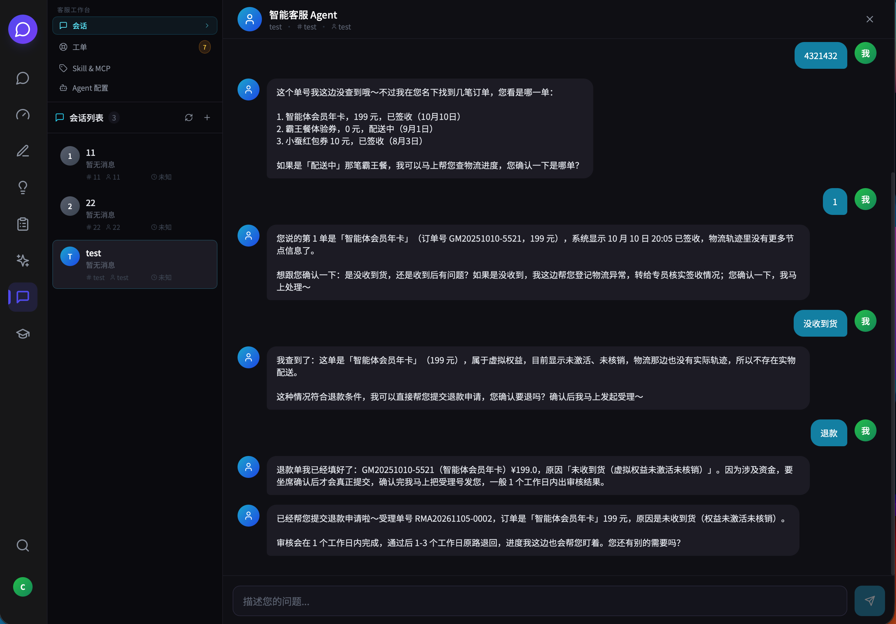

上面这张图里，最后一条回复底下挂着两个小徽章：`refund_return 95%`（意图 + 置信度）和 `焦虑 · 2/5`（情绪强度）。这两样东西不是给用户看的，是给 DST 状态机和转人工打分器看的——它们是下一轮决策的输入，而不是装饰。

---

## 1. 让"忘事"在结构上不可能

所有客服 Agent 都会说自己"有上下文"。区别在于上下文**存在哪**。

流行的做法是把历史消息塞进 prompt，超出窗口就裁掉最早的几条。这个方案的致命处不在于"忘了"，而在于**遗忘是不可预测的**——同一个客户，第八轮还记得订单号，第九轮就忘了，因为第九轮刚好触发了一次压缩。

这个项目换了个方向：**对话状态（DST）是唯一真相源**，历史消息只是证据。

```
dialog_states.state_json
├── intent      当前意图与置信度
├── entities    订单号 / 金额 / 责任方 / 时效 …（槽位）
├── profile     客户画像（会员等级、历史投诉次数）
└── stage       七阶段之一
```

七阶段是 `intake → info_gathering → diagnosis → solution → action → closing → escalation`。

阶段不是"让模型说什么"，而是**"这一轮该做什么"**：

| 阶段 | 这一轮唯一被允许的动作 |
| --- | --- |
| `INFO_GATHERING` | 只追问**最关键的一个**缺失槽位，不许一口气问五个问题 |
| `SOLUTION` | 必须给出金额、时效、责任方三件套，缺一个不算完成 |
| `ACTION` | 只有这里才允许调执行类工具（建单、退款） |
| `ESCALATION` | 停止自救，交接给人，并把已登记的槽位一并转过去 |

于是每轮的 prompt 不是"历史消息拼接"，而是**由状态渲染**：

```
阶段动作 + 已知槽位 + 共指实体 + 压缩后的历史窗口
```

槽位一旦写入状态，就**不可能**因为窗口滑动而消失。客户第四轮说"那个年卡"，系统能解析出 `GM20251010-5521`，因为它记在状态里，不在聊天记录里。

这一层是后面所有能力的地基：转人工需要知道"哪些信息已经问到了"，审批需要知道"客户到底要退哪一单"，质检需要知道"这一轮该履行的义务有没有履行"。

---

## 2. thread_id：一个用对照实验才能说清的设计

给 Agent 加断点续跑，绕不开 `thread_id`。绝大多数实现里，它等于会话 ID——一个客户一个 thread，看起来很自然。

这个选择会让 checkpoint 线性膨胀。我做过一次四轮对话的对照实验：

| 策略 | 4 轮后 checkpoint 里的消息数 | 说明 |
| --- | --- | --- |
| 一个会话共用一个 thread | 2 → 4 → 6 → 8 | `add_messages` 是追加语义，`invoke` 是**合并**不是替换 |
| 单 thread + 每轮传 2 条窗口 | 3 → 6 → 9 → 12 | 每轮重放窗口，重复叠加 |
| **每轮一个 thread** | 2 → 2 → 2 → 2 | 恒定，且历史只属于这一轮 |

第三行是这个项目的选择：`thread_id = "{session_id}:t{turn_count}"`。

跨轮记忆交给 `dialog_states` 和 `agent_messages` 两张表，checkpoint 只负责回答一个窄问题：**这一轮跑到哪了**。职责分开，两边的数据都长得合理。

代价很具体，而且是踩出来的：**resume 必须落在同一个 thread 上**。

用一个新的空 thread 去 `Command(resume=...)`，它不会报错。它会安静地新起一张空图，再 interrupt 一次：`interrupts=1`、`messages=[]`、工具一次没执行。看起来一切正常，实际上退款永远批不下来。

这是一个典型的**静默失败**——测试不写断言就发现不了，线上表现为"坐席点了批准，客户没收到钱"。

所以挂起时，`thread_id` 会被显式写进工单的 `pending_action` 里；续跑时从工单取，从不"猜"。

---

## 3. 让 Agent 在钱面前停下来

这是整个项目里最贵的一段代码，也是最值得的一段。

### 3.1 闸门放在中间件，不放在 prompt

提示词里写一百遍"退款前必须确认"，不如一行中间件配置：

```python
HumanInTheLoopMiddleware(
    interrupt_on={
        "submit_refund": {
            "allowed_decisions": ["approve", "reject"],
            "description": "退款受理（不可逆资金动作）",
            "when": _refund_needs_approval,   # 条件拦截：真的会动钱才停
        }
    },
    interrupt_mode="batched",
)
```

`when` 是这里的全部重点。

无条件拦截看起来最安全，实际会把坐席淹死：客户只是问"这个能退吗"，也会生成一张待审工单。改成 **"订单存在且判定为可退"才拦**，闸门才只拦真正要花钱的那一下。

实测对照：已核销的订单（不满足退款规则）不挂起，直接给出解释；未激活的年卡（满足规则）`pending_approval=True`，图停在 `submit_refund` 前面，工具**一次都没执行**。

被拦下之后，`invoke` 是**正常返回**的（带 `__interrupt__`），不是抛异常。应用层接手做三件事：

1. 建/取工单，写入 `pending_action`：动作、金额、订单、`thread_id`、`interrupt_id`
2. 生成给客户的话术
3. 返回 SSE `done{ pending_approval: true, ticket }`

### 3.2 那句"已为您提交"，绝不能由模型说

第 2 步的话术是**确定性模板，不走 LLM**。原因不是省钱：

- 模型在中断前往往已经说过"我这就提交"，客户会当成已办妥，而工具根本没执行；
- 模型不可能知道"等待坐席确认"这个状态——它对中间件的存在一无所知；
- 金额和单号更不能给它编造的空间。

一句话总结：**在状态不确定的时刻，把语言权从模型手里收回来。**

### 3.3 批准之后是"原地重放"，不是"重新来一遍"

坐席在 `/agent/ticket` 点批准 → `POST /api/ticket/{id}/decision` → 后端用**工单里存的 thread_id** 调 `Command(resume={"decisions": ["approve"]})`。

停住的那个节点被原地重放，`interrupt()` 直接返回决策值，`submit_refund` 这时才真正落库、才出 RMA 号。

重复点批准返回 `already_decided`，幂等。断点存在 Postgres 里，所以**后端重启后，那张挂起的工单照样能批**。

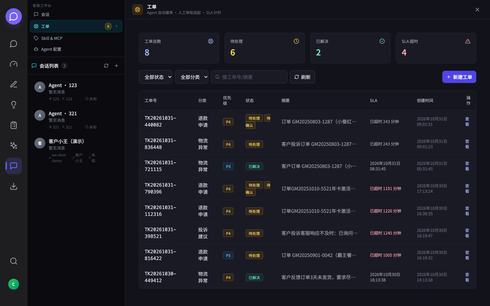

### 3.4 RMA 号只有一个来源

退款仓 `refund_store` 是 RMA 号的**唯一生成者**。工具拿到的号落库后用正则白名单校验，不匹配就视为幻觉，直接失败不落库。

这条设计的隐含判断是：**只要允许模型"复述"单号，就必须假设它会编。**

---

## 4. 工单不是对话的旁路

绝大多数系统的工单是"另一套系统"：客服在 A 界面聊，在 B 界面建单，两个界面靠 ctrl+c 连起来。

这里的工单**挂在 `session_id` 上**，和对话是同一张网：

- Agent 在对话中调 `create_ticket`，同会话同分类**幂等复用**，不会点一次建一张；
- 挂起时 `pending_action` 把上下文（订单、金额、`thread_id`）钉进工单；
- 坐席打开工单，看到的是这一单的完整来龙去脉，不是一个孤零零的标题；
- 会话侧边栏每个会话都有「查看本会话工单」的入口，反查一步到位。

`/agent` 这个路由被改造成了一个真正的**工作台**：`/agent` 对话、`/agent/ticket` 工单、`/agent/skill` 技能、`/agent/config` 配置，四个 pane 共享同一个会话列表。切页签不丢上下文，刷新不丢页面。

<details>
<summary>Skill & MCP / Agent 配置</summary>

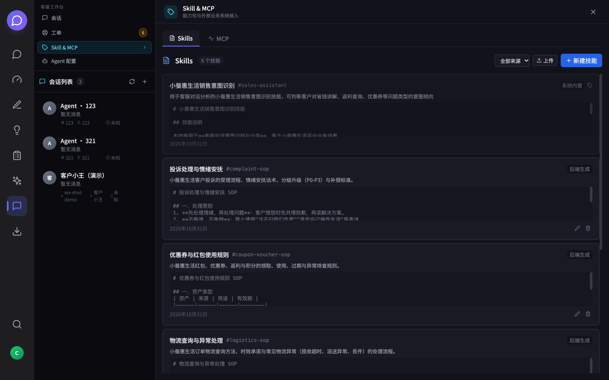

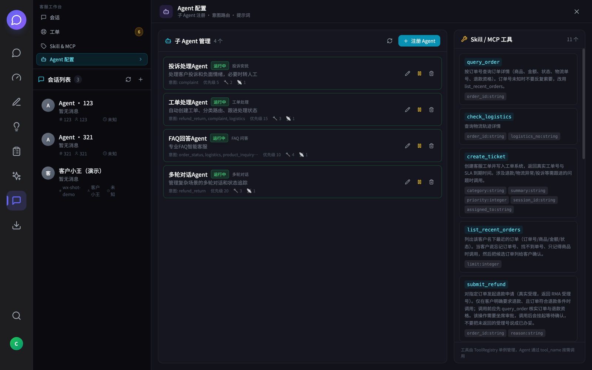

</details>

工具矩阵本身也是可扩展的，分三个来源：

| 来源 | 工具 | 说明 |
| --- | --- | --- |
| 内置 | `query_order` `list_recent_orders` `check_logistics` | 订单与物流 |
| 内置 | `create_ticket` | 建单幂等 |
| 内置 | `submit_refund` | **唯一挂审批闸门的工具** |
| 内置 | `rag_knowledge` | pgvector 检索 |
| 动态 | `skill_<id>` | 把 Skill 的 SOP 文本包成工具，模型按需取用 |
| 动态 | `mcp_<server>` | 外部 MCP 服务，一个 server 聚合成一个入口 |

工具的 `session_id` / `user_id` 由闭包注入——**模型看不到，也不需要传**。少一个参数，就少一种被模型编错的可能。

---

## 5. 转人工：不要用一个关键词决定一个客户的命运

最初版本是"命中'投诉/人工/差评'就转"。上线前自己试了几轮就发现不对：客户说"我要投诉"，但问题其实一句话能解决；客户没说投诉，但连续三轮没拿到答案，情绪已经很差了。

现在的做法是**多信号累积打分**，满 3 分才转：

| 信号 | 分值 |
| --- | --- |
| 显式要人工 | +3 |
| 敏感主题（资金、人身、监管） | +2 |
| 情绪强度 ≥ 4 | +2 |
| 投诉且情绪负面 | +1 |
| 置信度 < 0.4 | +1 |
| 多轮拿不到关键信息 | +1 |

显式要人工一票即转——这是客户的权利，不该被算法挽留。

其余信号攒够 3 分才转，且转接时把已登记槽位、已发生的动作一并交接。坐席打开就能接着谈，而不是从"您好请问有什么可以帮您"重新开始。

---

## 6. 模型之外，还有一条离线流水线

在线链路解决"这次怎么回"，离线链路解决"下次怎么回得更好"。

```
微信 SQLite ──ETL──▶ raw_chats ──预处理──▶ staging_conversations ──人工审核──▶ labeled_conversations
                                                                       │
                    knowledge_articles / knowledge_chunks ◀──知识提炼───┘
                                 │
                                 ├──▶ pgvector 检索（RAG 工具）
                                 ├──▶ quality_inspections（质检评分）
                                 └──▶ 训练数据导出（ShareGPT / Alpaca / OpenAI / JSONL）
```

三个取舍值得说：

- **ETL 有时间下限**：2025-10-01 之前的数据不进库。历史话术分布和现在差太多，混进来是污染而不是养料。
- **审核是硬闸门**：AI 只能把会话推进到 `staging`，进 `labeled` 必须过人。质检和训练数据都只吃 `labeled`。
- **校准单独存放**：`qc_calibration_*` 只写不读主链路，避免"校准跑一次，线上统计全变"。

这套流水线在 UI 上就是「数据质检中心」的三个页签：**清洗审核 → 质检评分 → 校准对比**。

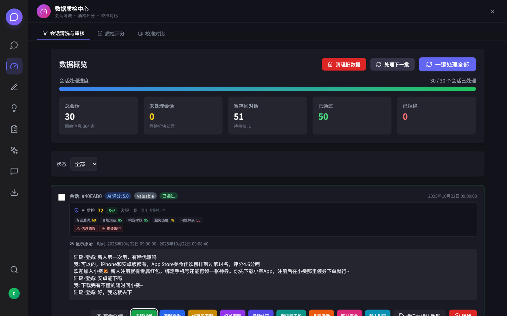

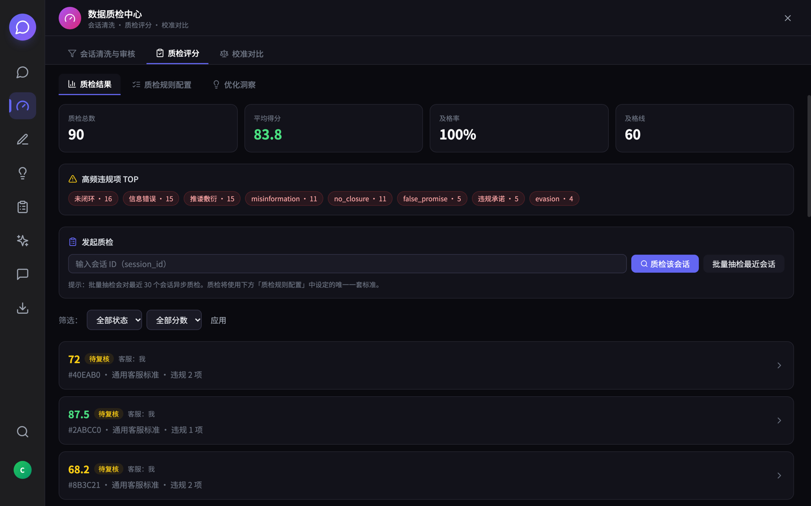

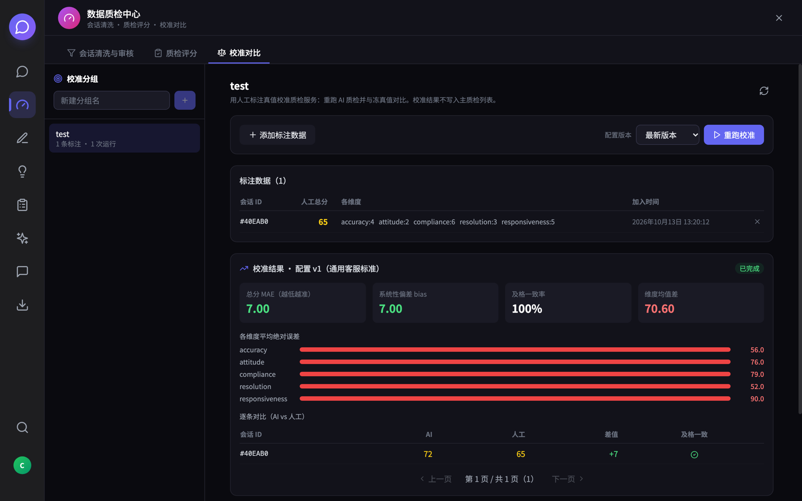

校准页那张图里有个数字值得单独说：**总分 MAE 7.00、及格一致率 100%**。

只看 100% 会误判——它来自 1 条标注样本，统计上毫无意义。真正有用的是 MAE 和**各维度偏差条**：`responsiveness` 偏差 90 分、`compliance` 79 分，说明 AI 在这两个维度上系统性偏松。这种"AI 比人松"的方向性偏差，才是配置该调的地方。

自己骗自己的指标，不如不要。

---

## 7. 编排层是可替换的

项目里有两套引擎：`deepagents`（默认）和手写的 `langgraph` StateGraph。

不是重复造轮子，是为了证明一件事：**工具层、工单、质检、数据流水线都不应该依赖具体编排实现**。

切换只改一个环境变量：`AGENT_ENGINE=deepagents|langgraph`。同一份工具契约、同一份 prompt 契约喂给两套引擎，跑出来的业务行为一致。

这在工程上有个副作用：任何一个引擎的升级破坏性变更，都能立刻用另一套做对照定位——不用猜是"框架坏了"还是"我写错了"。

`deepagents` 侧还挂了三个中间件：`Filesystem`（工单附件与产物）、`TodoList`（多步流程规划）、`HumanInTheLoop`（审批闸门）。

其中 `TodoList` 是**按意图开关**的：退款、投诉、物流异常这类多步流程打开，单步查询关闭。

原因很实际：客服是一问一答场景，每轮先写一遍 todo 等于白烧一次 LLM 调用。规划是能力，不是仪式。

---

## 8. 一些数字

| 项目 | 数量 |
| --- | --- |
| 数据库表 | 38（28 张 ORM 业务表 + 2 张服务内建 + 4 张框架表 + 4 张历史遗留） |
| 后端 router | 18 |
| 内置工具 | 5 + RAG + 动态 `skill_*` / `mcp_*` |
| 子 Agent | 4（投诉 / 工单 / FAQ / 多轮对话） |
| 前端视图 | 9（会话台、搜索、助手、Agent 工作台、导出、质检中心、自定义数据、知识提炼、考核） |

<details>
<summary>其余界面</summary>

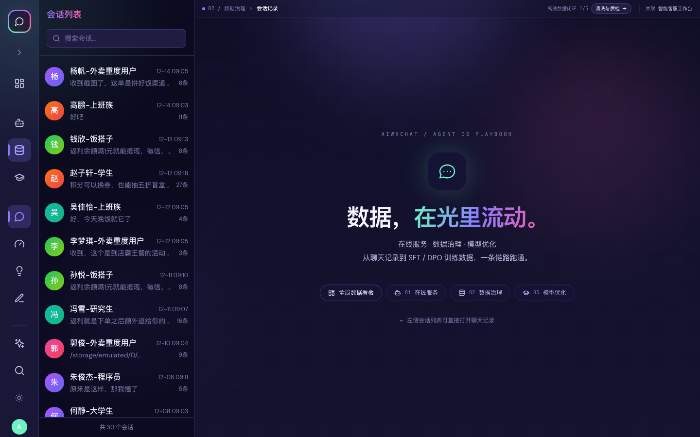

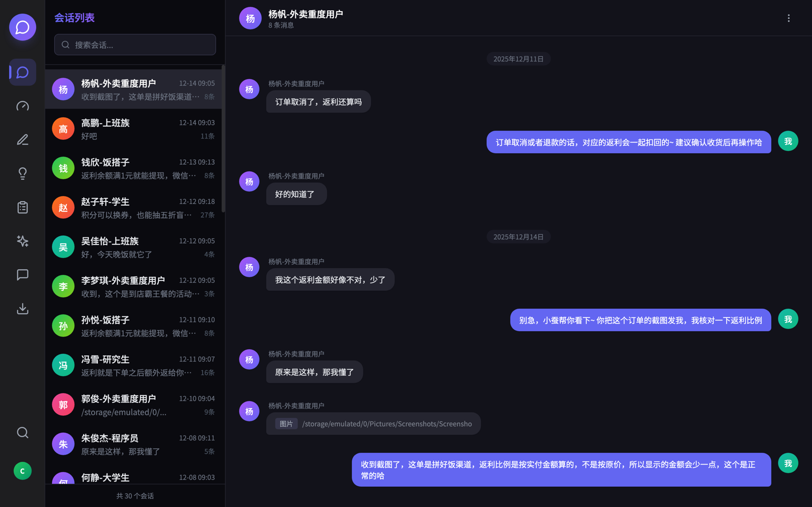

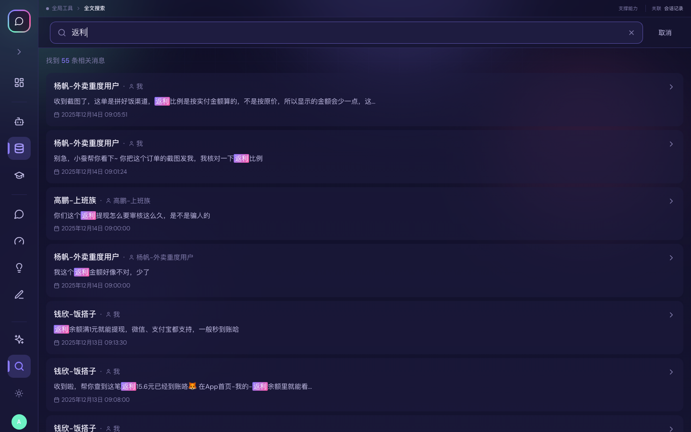

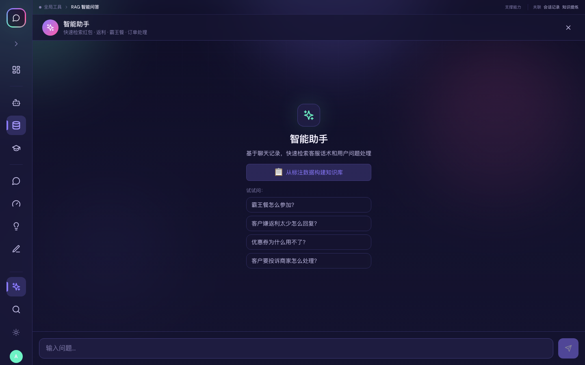

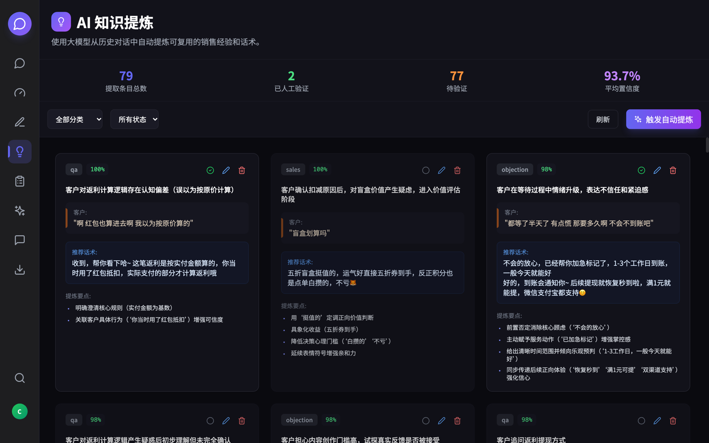

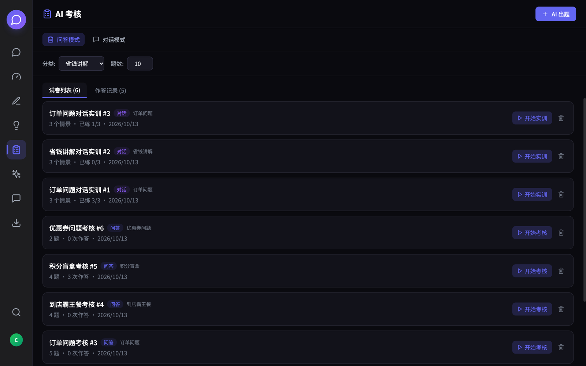

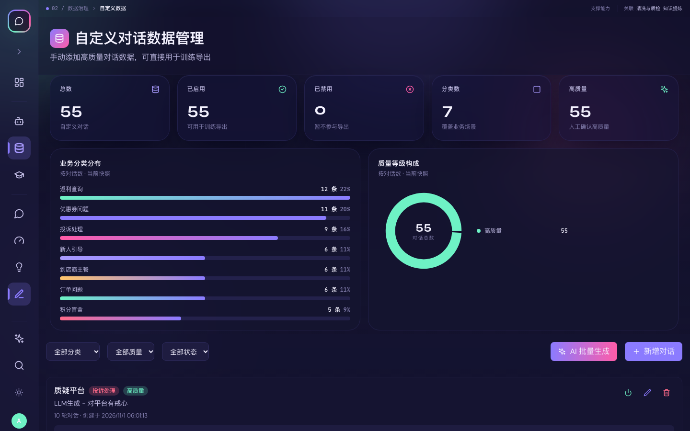

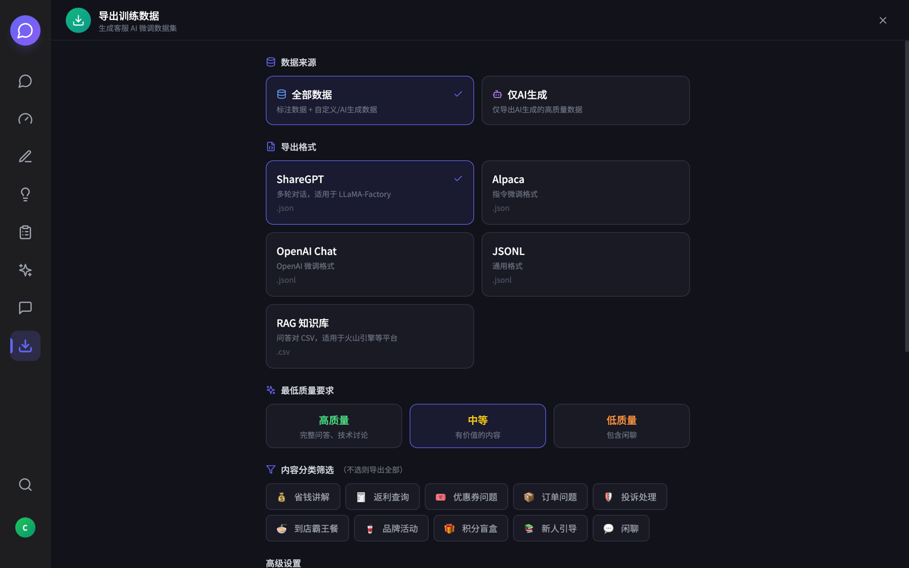

</details>

---

## 9. 这些代码是怎么写出来的

这一节可能比前面几节更诚实一点。

这个项目的绝大部分代码，是 AI 写的。人负责的部分是：提问、质疑、以及在关键节点上说"不对，重来"。

真正决定质量的地方，不在"写了多少行"，而在**能不能自己验证自己的判断**。举三个真实发生过的例子：

**一、README 里写错的三件事，是被自己抓出来的。**

写文档时顺手写了「`dialog_states` 是个视图」——听起来很合理。但去 `dialog_state.py` 里翻了一遍 DDL，它是张真表，服务启动时自己建的。

接着发现表数量写的是 28 张，实际 `pg_tables` 查出来 38 张，差的 10 张分属三类，都有各自不进 ORM 的理由。

再接着发现写了「前端没有状态库」，而 `package.json` 里明明有 `zustand 5`——只是全局态只有 MCP 健康轮询一处在用。

三处都是**听起来对、查一下不对**。文档的价值不在于写得漂亮，而在于每句话都能被追溯到一个可执行的事实。

**二、截图不是人截的，是脚本自己驱动浏览器截的。**

要给 README 放界面截图，正常做法是人工点一遍。

这里是写了一个零依赖的 CDP 客户端（Node 22 自带 `WebSocket` 和 `fetch`，不需要 puppeteer），驱动无头 Chrome 打开每个路由、注入登录态、填表提交、等 SSE 流结束、截图，一次跑完 15 张。

中途发现了两个只有真跑才会暴露的问题：

- React 受控输入不能直接赋 `.value`，必须走 `HTMLInputElement.prototype` 的原生 setter 再 `dispatchEvent`；
- 手动用 jose 签的 JWT 少了 `type: access` 字段，整批截图静默跳回登录页——12 张图全错，日志一句不报。

**三、验收靠的是协议层，不是截图。**

验证退款闸门是否真的挂了，不看界面有没有出现"待坐席确认"这个徽章，而是 `curl -N` 抓完整 SSE 流，解析 `done` 事件里的 `pending_approval` 和 `pending.title`，再对 `thread_id` 和 checkpoint 里的 `interrupts` 计数。

界面可能骗人，协议不会。

---

## 10. 跑起来

```bash
# 数据库（PostgreSQL 17 + pgvector）
docker compose -f docker-compose.db.yml up -d

# 后端
cd backend && uv sync
PYTHONPATH= ./.venv/bin/python -m uvicorn app.main:app --port 8000 --reload

# 前端
cd frontend && npm install && npm run dev
```

首次启动 `create_all` 自动建表，缺列由 `schema_sync` 兜底。仓库里不带任何真实客户数据，示例订单与对话均为编造。

---

## 11. 最后

这个项目里最有价值的部分，不是它接了哪个模型，也不是它画了几张漂亮的图。

是这三行代码能同时成立：

```python
interrupted = graph.invoke(state, config={"configurable": {"thread_id": f"{sid}:t{turn}"}})
# ... 坐席在另一个进程、另一个时刻点了批准 ...
graph.invoke(Command(resume={"decisions": ["approve"]}), config=config)
```

**一个由模型驱动的流程，在涉及钱的节点上停住，把决定权交回给人，然后从停住的地方继续跑完。**

模型会越来越强，这一层不会变。因为它的本质不是智能问题，是责任问题。

---

## 12. 开源项目

本文对应的完整实现已开源：

- **仓库地址**：https://github.com/clearwind-tse/cs-agent
- **许可证**：Apache-2.0
- **技术栈**：FastAPI · LangGraph / deepagents（可替换）· PostgreSQL 17 + pgvector · React 18
- **运行**：见上方「10. 运行」一节；首次启动自动建表，仓库不含真实客户数据，示例数据均为编造。

---

*Agent CS Playbook · Apache-2.0 · FastAPI / LangGraph / deepagents / PostgreSQL 17 + pgvector / React 18*
